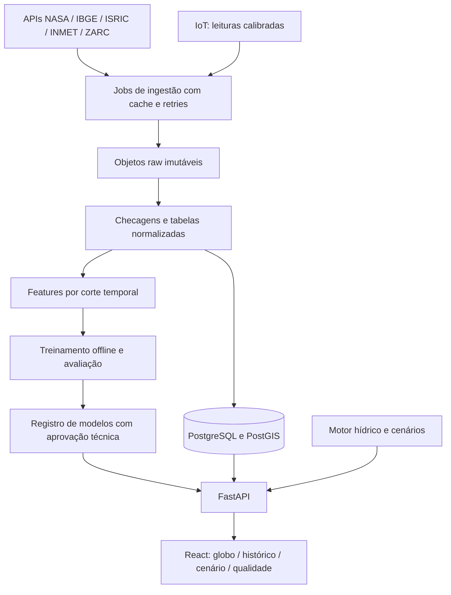

# Gaiapus — plano de implementação de dados, modelo, backend e frontend

> Para execução: seguir `superpowers:executing-plans`, implementando e verificando uma tarefa por vez. Este documento prepara o desenvolvimento; não afirma que a aplicação de produção já existe.

**Objetivo:** levar a base experimental MG/MT a uma aplicação que mostre evidências e simule cenários, publicando previsões somente quando os critérios de qualidade forem satisfeitos.

**Arquitetura:** ingestão e treino offline em Python; API de aplicação em FastAPI; armazenamento de brutos em objetos e tabelas relacionais/geoespaciais em PostgreSQL/PostGIS; frontend React/TypeScript com globo 3D. Uma API comum para dados observados, estimativas e cenários, com discriminação obrigatória de origem e qualidade.

**Stack proposta:** Python gerenciado por uv; FastAPI/Pydantic; PostgreSQL/PostGIS; arquivos Parquet e COG; scikit-learn para os primeiros modelos; React/TypeScript strict com bun; CesiumJS para navegação geográfica real, sujeito a validar licença/serviços de terreno utilizados. Evitar microserviços até haver necessidade operacional. A implantação e as versões da aplicação serão escolhidas no início do repositório real.

**Especificação:** [base e limites do produto](gaiapus-13-base-de-treinamento.md), [fontes](gaiapus-14-catalogo-e-qualidade.md), [treinamento](gaiapus-15-protocolo-de-treinamento.md). Estes documentos complementam os guias anteriores e prevalecem nas decisões específicas de treinamento desta coorte.

## Restrições globais

- Países no globo são navegáveis; capacidade agrícola publicada apenas em combinações brasileiras validadas. Nada de números fictícios ao selecionar outra região.
- Datas UTC em séries diárias e instante de emissão separado para previsões; a interface pode exibir fuso local sem alterar agregados científicos.
- Todo número tem unidade, suporte espacial, período, fonte, versão e status de qualidade.
- O modelo municipal não é apresentado como rendimento do talhão.
- Incerteza ausente não vira intervalo inventado; retorno deve indicar `uncertainty_unavailable`.
- Dados finais históricos não viram coleta em tempo real. Atualização respeita disponibilidade e latência do produto.
- Nenhuma integração será construída a partir do HTML demonstrativo como se já fosse um backend funcional.

## Fluxo de dados e aplicação



## Modelo de dados proposto

| Entidade | Chave / campos essenciais | Responsabilidade |
|---|---|---|
| source_asset | id, URL, hash, retrieved_at, product_version, license | Proveniência e reprocessamento |
| region | IBGE, tipo, pai, geometria, boundary_version | País → UF → município |
| field | id, geometria consentida, município, proprietário autorizado | Talhão real; separado do recorte demo |
| crop_season | id, field_id, crop, cultivar, sowing, harvest, management | Ciclo observado, não inferido silenciosamente |
| weather_daily | point/cell_id, day_utc, parameter, value, unit, quality, source_asset | Observações e estimativas históricas |
| forecast_value | issue_time, valid_time, member, variable, location, value | Futuro meteorológico com versão de emissão |
| soil_layer | geometry/field_id, depth_top/bottom, property, value, quantiles, method | Análise de solo ou mapa estimado |
| crop_label | municipality/crop/year ou field/season, yield, method, publication | Alvos distintos por escala |
| optical_observation | polygon, scene_id, date, sensor, NDVI, valid_fraction, asset | Imagens e índices com nuvens/gaps |
| zarc_profile | municipality, crop, safra, grupo, solo, manejo, decendio, risk | Regra versionada e portaria |
| feature_snapshot | entity, cutoff, availability_cutoff, version, hash | Reprodução da inferência |
| model_version | dataset_hash, feature_contract, metrics, limitations, status | Modelo candidato/aprovado/retirado |
| scenario | input_snapshot, assumptions, output, engine_version | Simulação imutável e reproduzível |
| telemetry | device, sensor, timestamp, calibration, value, unit, quality | Dados IoT, incluindo falhas e bateria |

Criar migrações no repositório da aplicação. Chaves únicas e validações devem impedir duplicação por reexecução. Não armazenar tokens assinados do Planetary Computer como URLs permanentes de datasets. Gerar acesso efêmero quando necessário, respeitando cache e expiração.

## Contratos HTTP propostos, ainda não implementados

| Método e rota | Entrada | Saída |
|---|---|---|
| GET `/v1/capabilities?municipality_code=...` | Município/cultura | Produtos disponíveis, períodos, status e razões de bloqueio |
| GET `/v1/regions?parent_code=...` | País/UF | Filhos e bounds para navegação |
| GET `/v1/weather?region=...&start=...&end=...` | Área e período | Série, unidades, cobertura, origem e ponto/célula |
| GET `/v1/imagery?field_id=...` | Talhão/recorte | RGB/NDVI, datas, cobertura e cenas rejeitadas |
| GET `/v1/zarc?...` | Município/cultura/safra/grupo/solo/manejo | Decêndios com categoria e portaria |
| POST `/v1/scenarios` | Cenário e hipóteses | Job ID; depois resultados diários e incerteza |
| GET `/v1/scenarios/{id}` | ID | Estado do job e snapshot de resultados |
| POST `/v1/predictions` | Alvo, escala, cutoff, versão/inputs | Previsão permitida ou motivo explícito de indisponibilidade |
| GET `/v1/data-quality?region=...` | Recorte | Cobertura, lacunas, versões e limitações |

Exemplo de bloqueio honesto para um pedido de rendimento de talhão com o modelo atual:

```json
{
  "status": "unavailable",
  "requested_scale": "field",
  "supported_scale": "municipality_research",
  "reason_codes": ["FIELD_YIELD_MODEL_NOT_VALIDATED"],
  "yield_kg_ha": null,
  "model_version": "research_v1",
  "dataset_version": "training_v1"
}
```

Exemplo de entrada para replay hídrico, somente depois de implementar o motor:

```json
{
  "municipality_code": "3170206",
  "crop": "soy",
  "mode": "historical_counterfactual",
  "sowing_date": "2023-11-05",
  "phase_profile": "soy_group_II_reference",
  "soil_source": "zarc_reference_AD4",
  "initial_water_fraction": 0.7,
  "rain_multiplier": 0.5,
  "modified_phase": "reproductive",
  "request_yield_estimate": false
}
```

Os valores de água inicial e redução de chuva são hipóteses escolhidas, não observações. A API deve devolver essa identificação. Não calcular lucro com `yield_kg_ha=null`.

## Telas necessárias

1. **Explorar:** globo 3D, busca textual e seleção país → UF → município; limites geográficos oficiais. Controles acessíveis e alternativa 2D. Carregamento gradual sem baixar tudo ao abrir.
2. **Disponibilidade:** antes de mostrar números, indicar o que está validado para município/cultura/período. A navegação pode chegar a qualquer região; os dados não surgem automaticamente.
3. **Fazenda/talhão:** desenhar ou importar polígono, confirmar cultura/cultivar e plantio, informar irrigação, solo e manejo; recorte demonstrativo explicitamente separado.
4. **Histórico:** imagem real datada, NDVI com cobertura e chuva por período. Eixos e unidades separados; lacunas visíveis. Exibir área de suporte e não apenas um ícone de satélite.
5. **Planejar plantio:** opções somente após restrições ZARC, calendário sanitário e disponibilidade de recursos. Abas de produtividade, margem e critérios de solo. Informar referência dos custos/preços.
6. **Lavoura plantada:** estágio observado ou estimado, comparação de histórico e cenários, balanço hídrico quando disponível. Não mostrar uma recomendação de irrigação enquanto o balanço não estiver calibrado.
7. **Cenários:** linha do tempo, intensidade/duração de seca, fase afetada, dados fixados no cenário e diferença em água/estresse. Animação 3D acompanha o resultado calculado.
8. **Qualidade/fontes:** versões, lacunas, proximidade de estação, produto meteorológico, cobertura de pixels e limites do modelo.

## Plano de execução por entregável

### Tarefa 1 — congelar e verificar a base

Responsável: dados. Arquivos já existentes: `data/ingest/training_foundation.py`, `soil_context.py`, `station_reference.py`, `tests/test_training_foundation.py`.

- [ ] Executar `python -m unittest discover -s tests`; todos devem passar.
- [ ] Verificar hashes do manifesto final e contagens contra `quality_report.json`.
- [ ] Revisar cada exclusão e cada estação sem cobertura; nenhuma ausência preenchida por zero.
- [ ] Salvar versão do ambiente e copiar a base para armazenamento de objetos com leitura restrita às alterações de pipeline.

Entrega verificável: mesmos CSVs e hashes ao reprocessar os mesmos brutos; relatórios explicam toda exclusão.

### Tarefa 2 — corrigir a unidade espacial do experimento

Responsável: dados/geoprocessamento. Criar no futuro `data/ingest/crop_weighted_weather.py` e `tests/test_crop_weighted_weather.py`.

- [ ] Definir uma máscara anual de soja/milho com fonte, versão, resolução, período e avaliação de qualidade; verificar acesso e licença antes de implementação.
- [ ] Teste: duas células com áreas cultivadas 1 e 3, chuva 10 e 30 mm, retornam 25 mm; células ausentes não recebem peso zero silencioso.
- [ ] Implementar `aggregate_crop_weather(cells, weights, cutoff)` preservando cobertura espacial e temporal.
- [ ] Comparar ponto vs agregado sem mudar alvos/splits; registrar ganho ou ausência de ganho.

Entrega: dataset v2 com suporte espacial coerente. A máscara é uma dependência pendente, não um arquivo já adquirido nesta rodada.

### Tarefa 3 — validar chuva e preparar ET0

Responsável: dados/agronomia. Criar `data/ingest/station_rain_validation.py`, `data/features/evapotranspiration.py` e testes correspondentes.

- [ ] Fixar convenção temporal do INMET por documentação e exemplo de fronteira à meia-noite.
- [ ] Teste: dia com 23 horas válidas não gera precipitação diária comparável; zero real continua zero.
- [ ] Consultar IMERG nos pontos das estações e comparar somente pares alinhados; não escolher tolerância depois de olhar teste.
- [ ] Testar Penman–Monteith contra exemplo publicado FAO-56, incluindo unidades e ausência de dados; implementar ET0 diária e VPD com flags.

Entrega: relatório por estação/mês e features de demanda hídrica auditáveis.

### Tarefa 4 — modelos e dataset de campo

Responsável: IA, com agrônomo/produtor para rótulos. Script base: `data/ingest/training_baseline.py`.

- [ ] Executar ablações do protocolo, mantendo o teste final fechado.
- [ ] Obter dados reais de talhão usando `data/templates/field_harvests.csv`; recusar duplicações de uma safra como novos alvos.
- [ ] Implementar intervalos e comparação MLP apenas após melhoria dos dados.
- [ ] Publicar model card com unidade-alvo, horizonte, populações cobertas, métricas, vieses e proibições.

Entrega: candidato tecnicamente avaliado; nenhum registro de modelo é marcado `approved` apenas porque treinou sem erro.

### Tarefa 5 — primeiro backend funcional

Responsável: backend. Futuro repositório `gaiapus-app`, arquivos propostos `backend/app/main.py`, `backend/app/contracts.py`, `backend/app/services/data_catalog.py`, `backend/tests/test_capabilities.py`.

- [ ] Teste: município fora da coorte retorna capacidade de navegação, mas não previsão agrícola inventada.
- [ ] Implementar primeiro capabilities, regiões, histórico e qualidade usando os CSVs normalizados; sem disparar treino em requisição HTTP.
- [ ] Adicionar persistência e autenticação por propriedade; testes de acesso entre usuários a talhões privados.
- [ ] Implementar cenários como jobs com snapshot e idempotência. Resultado municipal não pode satisfazer pedido de talhão.

Entrega: API de leitura verificável e contrato de indisponibilidade, antes da inferência publicada.

### Tarefa 6 — frontend a partir do contrato

Responsável: frontend. Arquivos propostos `frontend/src/features/globe/`, `observations/`, `scenarios/`, `quality/` e cliente gerado do OpenAPI.

- [ ] Teste de fluxo: Brasil → Minas → Uberlândia mantém seleção e data; voltar não duplica pedidos.
- [ ] Exibir série real e lacunas; imagem sem data/cobertura fica indisponível.
- [ ] Testar região sem dados, API indisponível, cena com nuvens e tela pequena.
- [ ] Implementar 3D como representação do cenário, com comparação acessível em gráficos/tabela e sem valores sintéticos ocultos.

Entrega: percurso navegável que comunica honestamente capacidade e limitações.

### Tarefa 7 — IoT, depois do contrato de observação

Responsável: hardware. Priorizar umidade volumétrica calibrada, temperatura do solo, pluviometria quando viável, energia/bateria e timestamps. Backend deve aceitar amostras atrasadas e marcar calibração/falhas. ESP32 com Rust/embassy/esp-hal é preferência de implementação do projeto; interface de ingestão independente do transporte LoRa/Wi-Fi/celular escolhido em campo.

- [ ] Calibrar sensor em amostras de solo local e registrar curva/unidade/profundidade.
- [ ] Testar reconexão, duplicação e clock errado antes de usar observação no balanço hídrico.
- [ ] Separar observação de mapa espacial e observação de dispositivo no contrato/API.

## Foco da revisão

Os cinco erros que mais invalidariam o produto são: futuro vazando no treino; rótulo municipal apresentado por talhão; chuva ausente virando zero; recomendação fora do sistema ZARC/cultivar/manejo; lucro calculado com preço ou custo incompatível. As tarefas acima devem demonstrar explicitamente o comportamento correto para cada um antes de publicação.

## Primeiro dia de trabalho da equipe

Dados/IA começa por contagens, exclusões, ablação e definição da máscara agrícola. Backend começa por capabilities e dados históricos, com esquema de proveniência. Frontend começa pelo fluxo do globo e estados de disponibilidade, usando contrato real. Hardware prepara o registro de leituras/calibração. Não bloquear a leitura de dados públicos no aplicativo enquanto o modelo de talhão ainda não existe; também não preencher esse espaço com previsões fictícias.
