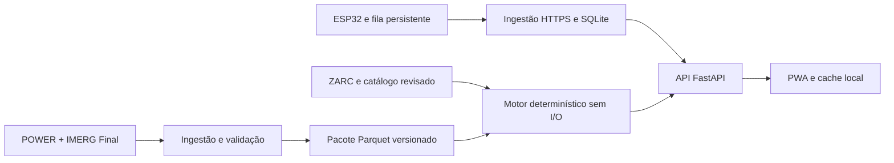

# Gaiapus — plano técnico do MVP Field Shift

**Data:** 13/11/2026. **Recorte:** um talhão de culturas anuais no entorno de Uberlândia, Triângulo Mineiro. **Posicionamento:** Local Impact. Este plano detalha a execução da [proposta](../../../proposta-gaiapus.md) e do [plano resumido](2026-11-11-gaiapus-mvp.md).

**Entrega demonstrável:** cadastrar um talhão, comparar até três sequências aptas para duas janelas sucessivas, mostrar a origem de cada critério e integrar uma leitura real de solo. Um cenário de sequeiro com uma decisão real de safra é o primeiro caso. A apresentação pública é material de comunicação. A implementação do produto começa como projeto próprio.

**Arquitetura escolhida:** PWA em TypeScript, API FastAPI/Python, ingestão meteorológica fora do caminho da requisição, Parquet para séries e SQLite em instância única para piloto. Firmware no ESP32, com Rust (`esp-hal`, `embassy`, `no_std`) quando a placa e os drivers passarem na bancada. Usar bun e uv. Nomear um responsável por aplicativo, dados/agronomia e IoT, mais um responsável pela integração. A revisão de regras exige agrônomo; a coleta de feedback exige produtor parceiro.

O Claude Code propôs um motor de funções puras, armazenamento separado para séries e metadados, e execução em fatias com critérios de aceite. Mantive essa estrutura e ajustei o modelo hídrico, a elegibilidade ZARC e a API ao escopo da equipe.



## 1. Missões e produtos escolhidos

| Prioridade | Missão ou serviço | Produto exato e escala | O que pegar | Como entra |
|---|---|---|---|---|
| MVP | **GPM Core Observatory (NASA/JAXA) e constelação de parceiros** | **IMERG Final diário V07**, `GPM_3IMERGDF`, 0,1° (~11 km norte–sul) | Precipitação diária, carimbo UTC, célula, versão, run e flags disponíveis | Chuva acumulada e frequência de períodos secos durante janelas/fases candidatas |
| MVP | **NASA POWER**, serviço de dados | Daily Point, comunidade AG, UTC. Meteorologia de reanálise e radiação das fontes indicadas na documentação POWER | `T2M_MIN`, `T2M_MAX`, `ALLSKY_SFC_SW_DWN`. `T2M` se necessário para visualização | Contexto térmico, dias quentes por regra validada e radiação histórica. Resolução preservada por variável. |
| Pós-MVP | **SMAP** | `SPL4SMGP` v8, 9 km EASE-Grid 2.0, EPSG:6933, média de 3 h | Umidade superficial 0–5 cm e estimativa da zona radicular 0–100 cm, flags e cobertura | Contexto regional. Comparar apenas escalas e profundidades compatíveis; o produto assimila observações em um modelo. |
| Pós-MVP | **Landsat 8/9 e Sentinel-2** | NASA HLS v2, `HLSL30` e `HLSS30`, COGs em grade de 30 m | Vermelho B04, infravermelho próximo B05 (L30) / B8A (S30) e Fmask. Usar fatores do produto. | Mediana do NDVI por talhão usando pixels válidos, com data, fração observada e mínimo de cobertura. NDVI é indicador de vegetação. |

Fontes oficiais: [catálogo CMR/GES DISC](https://cmr.earthdata.nasa.gov/search/site/collections/directory/GES_DISC/gov.nasa.eosdis), [NASA POWER Daily](https://power.larc.nasa.gov/docs/services/api/temporal/daily/), [origens e variáveis do POWER](https://power.larc.nasa.gov/docs/methodology/data/sources_meteorology/), [SMAP v8](https://nsidc.org/data/spl4smgp/versions/8), [HLS e Fmask](https://hls.gsfc.nasa.gov/data-products/).

**Decisão de acesso.** No MVP, buscar chuva e meteorologia em uma requisição POWER, usando `IMERG_PRECTOT` para precipitação. Conferir a janela e versão no catálogo IMERG. Se o retorno do POWER não oferecer proveniência suficiente para verificação do run ou versão, registrar `run=unverified` e gerar o artefato oficial com granules Final V07 obtidos via Earthdata Search/GES DISC. Usar NASA Earthdata Login no fluxo autenticado, armazenando a credencial fora do repositório. Fixar `short_name=GPM_3IMERGDF` e `version=07`. Consultar pelo polígono ou caixa de recorte e intervalo. Extrair a célula contendo o ponto/intersectando o talhão; ler unidade, máscara e variável do arquivo. Comparar o mês de referência entre os dois caminhos, com tolerância explícita de arredondamento e mesma célula/dia antes de promover POWER como fonte historicamente equivalente.

**Recorte temporal.** Começar com 01/01/2024–31/03/2024 (91 dias) e depois expandir para 01/01/2016–31/12/2024 (3.288 dias). São anos completos para construir cenários, sem interpretar frequência amostral como previsão. Segundo o aviso da NASA, o Final V07 termina em setembro de 2025. Consultar o catálogo antes de adotar V08. Gerar versões separadas e comparar o período comum antes de qualquer troca. Não anexar Late/Early à referência Final como se fossem a mesma série. POWER entrega IMERG diário em UTC e pode apresentar Late próximo do presente. [Transição V08](https://gpm.nasa.gov/data/news/imerg-v08-transition-schedule), [atualização NASA](https://gpm.nasa.gov/data/news/update-imerg-v08-transition-schedule-aug-2026), [diferenças entre runs](https://gpm.nasa.gov/resources/faq/what-are-differences-between-imerg-early-late-and-final-runs-and-which-should-be-used).

**Evolução:** a série SMAP v8 usa, entre outros insumos, precipitação IMERG V07 fora de certas regiões, portanto não é validação independente dessa precipitação. O catálogo sinaliza reprocessamento dos dados L4 de 14/05 a 28/07/2026; excluir ou marcar esse intervalo até confirmar no catálogo a versão corrigida. Para HLS, reprojetar o polígono do talhão à grade do tile, aplicar máscara de nuvem, sombra e borda conforme documentação, descartar nodata e documentar limite de cobertura válido. Usar `(NIR - RED)/(NIR + RED)` apenas quando o denominador permitir. Lavouras com poucos pixels válidos retornam informação limitada.

## 2. Solo, calendário e evidência de campo

| Fonte | Aquisição | Campos e uso |
|---|---|---|
| **ZARC/MAPA** | SISZARC → relatórios → publicações. Exportar XLS/PDF por safra, MG, município e cultura. Arquivar portaria e vigência. | Código IBGE, cultura, grupo de ciclo/cultivar se aplicável, categoria de solo/água disponível do ato, decêndios e faixa de risco publicada. Usar como filtro de elegibilidade. |
| **Agrônomo e Embrapa** | Ficha pequena revisada para quatro candidatos no máximo. Começar por soja e milho; milheto e crotalária são opções para discussão. | Duração/fases, janela local, grupo botânico, disponibilidade de semente, restrições de sucessão, exigência hídrica por fase e potencial de cobertura. Cada regra tem fonte e versão. |
| **Solo local** | Entrevista e laudo do produtor quando houver autorização de uso | Textura, profundidade de amostragem, drenagem, classe/AD do ZARC quando confirmada e data. pH e matéria orgânica ajudam na caracterização quando disponíveis. |
| **SoilGrids/ISRIC** | Recortar as camadas 250 m de areia, silte e argila em 0–5, 5–15 e 15–30 cm. | Mediana e quantis 5/95 quando disponíveis. Converter unidades segundo a tabela do ISRIC. Exibir estimativa. Não inferir classe ZARC só pelo pixel. |
| **INMET / pluviômetro local** | Escolher estação mais representativa com período e cobertura suficientes, comparar com interseção temporal | Precipitação e temperatura, coordenadas, altitude e convenção do dia. Comparar totais e viés por janela e concordância de dias secos. Registrar distância, lacunas e diferença de escalas. |
| **Produtor e IoT** | Formulário e cadastro do ponto de instalação | Histórico de cultivo, datas, irrigação, restrições, prioridade, umidade/temperatura do solo e qualidade de leitura. |

[Exportação SISZARC](https://www.gov.br/agricultura/pt-br/assuntos/riscos-seguro/programa-nacional-de-zoneamento-agricola-de-risco-climatico/siszarc) · [Referência de soja MG](https://www.gov.br/agricultura/pt-br/assuntos/riscos-seguro/programa-nacional-de-zoneamento-agricola-de-risco-climatico/portarias/safra-vigente/minas-gerais/PORTN200SOJAMG.pdf/view) · [Embrapa, rotação de culturas](https://www.embrapa.br/web/agencia-de-informacao-tecnologica/tematicas/sistema-plantio-direto/fazendo-certo/planejando-e-executando/fase-de-implantacao/organizando-o-sistema-produtivo/rotacao-de-culturas) · [SoilGrids, unidades e quantis](https://docs.isric.org/globaldata/soilgrids/SoilGrids_faqs_01.html) · [INMET/BDMEP](https://portal.inmet.gov.br/servicos/bdmep-dados-historicos).

**Sem linha do ZARC:** registrar `not_found` separadamente de `outside_window`. Coberturas sem linha oficial só entram quando houver regra local revisada e marcada como tal. Para culturas comerciais que exigem referência confirmada, retornar `limited` se faltar enquadramento.

## 3. Aquisição e processamento

### Primeiro download reproduzível

O ponto abaixo é ilustrativo e usa longitude antes de latitude na chamada. A equipe troca pela localização aprovada do piloto.

```powershell
$gaiapusPower = 'https://power.larc.nasa.gov/api/temporal/daily/point'
$gaiapusQuery = 'parameters=T2M_MIN,T2M_MAX,ALLSKY_SFC_SW_DWN,IMERG_PRECTOT&community=AG&longitude=-48.28&latitude=-18.92&start=20240101&end=20240331&format=JSON&time-standard=UTC'
Invoke-RestMethod "${gaiapusPower}?${gaiapusQuery}" |
  ConvertTo-Json -Depth 20 |
  Set-Content -Encoding utf8 'power-uberlandia-2024q1.json'
```

Para congelar o bruto em produção, salvar os bytes HTTP diretamente, sem reserializar. Validar a presença de `properties.parameter`, `header.fill_value`, unidade por variável e o intervalo de datas. `IMERG_PRECTOT` é total diário em mm. Normalizar radiação para MJ/m²/dia apenas após conferir metadados (kWh/m²/dia × 3,6 quando esta for a unidade). Ler máscara e atributos da coleção Earthdata; caso a precipitação esteja expressa como taxa, converter ao total com o intervalo documentado antes de comparar. Evitar baixar imagens globais e períodos que o piloto não vai usar.

**Resposta conferida em 13/11/2026.** Para o ponto ilustrativo e o trimestre acima, a API POWER Daily v2.10.3 retornou 91 datas por variável, incluindo 29/02, com zero valores ausentes nos quatro campos. O cabeçalho informou UTC, preenchimento `-999.0` e fontes MERRA2, SYN1DEG, IMERG e POWER. Em 01/01/2024, a resposta trouxe mínima de 21,22 °C, máxima de 27,94 °C, radiação de 13,41 MJ/m²/dia e chuva de 12,95 mm no dia. O ensaio confirma parâmetros e formato do POWER. A equivalência com a coleção direta do IMERG Final e a cobertura dos nove anos ainda são tarefas de implementação.

### Pipeline e contratos de dados

1. **Captura:** `raw/{source}/{collection}/{batch}/`, checksum SHA-256, parâmetros, versão/run, datas de aquisição/disponibilidade, célula/tile, URL de origem e licença/citação. Cachear por célula, produto, versão, período e padrão temporal.
2. **Normalização:** `daily_weather.parquet` com `cell_id, day_utc, rain_mm, t_min_c, t_max_c, radiation_mj_m2, status_by_variable, source_refs`. Preservar zeros. Converter sentinela, nulidade ou preenchimento para `null`. Bloquear duplicata conflituosa, chuva negativa e mínima superior à máxima. Registrar como `suspect` quando a regra de qualidade exigir revisão.
3. **Alinhamento:** indexar dia meteorológico em UTC; apresentar hora de telemetria em America/Sao_Paulo com indicação de fuso. A comparação com estação depende do mesmo intervalo de acumulação. Guardar coordenadas requisitadas e da célula; células chuva e temperatura podem ser diferentes. Se o talhão interceptar várias células, mostrar que a v1 usa ponto representativo; ponderação por área é extensão explicitamente versionada.
4. **Atributos:** soma de chuva de 7/30 dias apenas com série completa no intervalo, `valid_days`, número de dias secos (limiar preliminar <1 mm/dia configurável), maior sequência contínua de dias secos, percentis empíricos de chuva na janela da cultura. Ausência interrompe sequência. Só publicar percentis com pelo menos seis anos completos para a janela e mostrar `n_years`; essa é uma regra do MVP, sujeita à revisão.
5. **Disponibilização:** publicar pacote versionado de dados e catálogo com manifesto. A API lê o último pacote validado. Reinício ou indisponibilidade externa preserva o pacote e sua data. A PWA lê sempre a própria API. Nenhuma chamada NASA síncrona no botão de recomendação.

## 4. Motor explicável

1. Gerar pares de cultivos com início e fim a partir de janelas revisadas, duração e intervalo operacional. Proibir sobreposição e sucessões identificadas no catálogo.
2. Validar ZARC e restrições obrigatórias do produtor para cada candidato. Falta de informação de solo/água que afete elegibilidade gera pedido de confirmação. Power/IMERG históricos fornecem cenários, não alteram a portaria.
3. Para cada sequência viável, mostrar **água** (frequência histórica de ultrapassar o limiar de dias secos na fase sensível, limiar vindo do catálogo) e **cobertura** (dias estimados sob cultivo/cobertura no horizonte, limitados à interseção das datas, com pressupostos explícitos). Só contar palhada residual se houver regra revisada. Indicador hídrico é um proxy, sem estimar déficit absoluto ou produtividade.
4. Ordenar pelo critério escolhido e usar o outro para desempate, com ID estável como último desempate. Avaliar apenas alternativas com os dois fatores comparáveis. Mostrar os fatores sem nota agregada no cartão. Se houver apenas uma sequência elegível, mostrar uma. Se a evidência for insuficiente, mostrar estado limitado e o motivo.
5. Regra versionada em YAML com identificador, origem, parâmetros e revisão. Resultado guarda `run_id`, versão do motor, pacote, catálogo e referências. Sensor recente e calibrado pode enriquecer diagnóstico local. Uma leitura isolada fica fora da ordenação padrão.
6. ML futuro: definir alvo de umidade no mesmo sensor e profundidade em 24 h, usar só covariáveis disponíveis no instante da previsão, comparar MAE com persistência e avaliar propriedades e períodos não vistos. Incorporar ao produto só com ganho demonstrado e monitoramento de falhas.

**Interfaces internas:** `evaluate_rotations(field, catalog, weather, rules) -> Evaluation` é uma função pura. A API resolve fontes, casos e catálogos antes de chamá-la. Para cada fator, guardar valor, unidade, horizonte, anos incluídos e ID da regra. Indicadores de calor ou chuva no estabelecimento podem entrar após revisão dos limiares. Um balanço diário do tipo balde é extensão condicionada à validação de água disponível, evapotranspiração, coeficientes de cultura e balanço contra referência, sem usar a sonda isolada como verdade da zona radicular.

## 5. Aplicativo e contratos

| Interface | Entrada e comportamento esperado |
|---|---|
| `POST /recommendations` | `field_id, latitude, longitude, planting_date, previous_crops, water_regime, soil_class, priority, constraints`. `priority` = `water` ou `cover`. Retorna `status=ready/limited`, `run_id`, opções, `excluded`, `missing_fields`, fatores e evidências com IDs. HTTP 422 para esquema inválido; análise limitada ainda é um resultado válido. |
| `POST /telemetry` | Token por dispositivo em HTTPS. Vincular dispositivo ao talhão no servidor. Retorna `event_id` com `accepted` ou `duplicate`. Mesmo ID com payload divergente vira 409. |
| `GET /fields/{field_id}/telemetry/latest` | Retorna leitura com metadados ou estado `unavailable`. Servidor calcula idade, origem, profundidade e calibração. |
| PWA | Cadastro → diagnóstico → comparação → detalhe. Último diagnóstico salvo localmente com hora e versão. Quando offline, indicar que o plano consultado é o último salvo. Indicar lacuna e idade do sensor de forma independente. |

Contratos em `contracts/` com JSON Schema/OpenAPI, exemplos e unidades. Gerar ou validar os tipos TypeScript a partir do OpenAPI em modo strict. API separa `api/recommendations/` de `api/telemetry/`, pipeline em `data/ingest/`, `data/features/`, `data/catalog/`. Armazenar o diagnóstico consultado em IndexedDB e cachear os arquivos da PWA via service worker. Proteger coordenadas precisas, identidade e telemetria em área de acesso autorizado; na demo pública usar ponto ilustrativo e kit cadastrado para teste.

## 6. Dispositivo ESP32

- [ ] Calibrar sonda no solo de interesse com método de referência documentado, guardando faixa válida, erro e ID de calibração. Enquanto não calibrada, publicar `moisture_m3_m3=null` e `raw_moisture` com indicação de unidade/escala; manter temperatura em °C. Medir tensão em mV quando o circuito suportar.
- [ ] Capturar evento com `event_id, device_id, observed_at, depth_cm, moisture_m3_m3, raw_moisture, soil_temp_c, battery_mv, quality`. Sincronizar relógio UTC. Marcar amostra sem horário confiável e excluir das janelas; nunca usar hora de chegada como se fosse hora de medição.
- [ ] Amostrar a cada 15 min como ponto de partida. Definir capacidade inicial de 192 eventos (48 h), medir desgaste de flash e consumo. Escrever em fila persistente antes do envio, recuperar após reboot, preservar ID e liberar somente após confirmação. Se lotar, registrar perda e sinalizar no diagnóstico.
- [ ] Provar em Wi-Fi com backoff. Escolher caixa, autonomia e transmissão de campo após teste, com LoRaWAN e gateway considerados apenas em expansão. Manter protocolo de aplicação idempotente em qualquer conectividade.

## 7. Execução da equipe e pontos de aceite

| Marco | App | Dados/agronomia | IoT | Evidência de conclusão |
|---|---|---|---|---|
| 0. Contratos | Cadastro com exemplo JSON | Confirmar município, janela e duas alternativas com agrônomo | Escolher placa, sonda e payload | Todos consomem o mesmo caso `field-demo-01` |
| 1. Primeira fatia | Cadastro → resultado com fonte | Baixar trimestre, conferir três dias e ingestar duas séries; extrair portaria e catálogo | Amostra válida em bancada com flag de calibração | Uma recomendação ou abstenção reproduzível sem hardware |
| 2. Integração | Comparar até três alternativas e última leitura | Série completa, recortes, regras e `run_id` | Publicar leitura real e provar retry | API e painel usam o mesmo talhão; desligar Wi-Fi e reconectar sem duplicar |
| 3. Ensaio | Revisão produtor/técnico e modo offline | Validação em janela apta, fora da janela e dados insuficientes | Provar reinício durante fila e medir consumo | Demo reproduzível, pacote congelado e feedback documentado |

- [ ] **Dados:** 91 datas esperadas no trimestre; distinguir `rain_mm=0` de `null`, registrar dias faltantes; conferir sinal de longitude, grade, versão e unidade. Em 2016–2024, enumerar as 3.288 datas incluindo dias bissextos, reportando a cobertura por variável.
- [ ] **Agronomia:** caso fora da janela rejeitado; cobertura com regra local tem proveniência; classificação muda entre prioridades quando os fatores realmente divergem; abstenção se requisito obrigatório ausente.
- [ ] **IoT:** três eventos enviados, um reenvio e um payload divergente. Três linhas únicas. Reinício sem Wi-Fi preserva a fila. Sem calibração, volume nulo. Sem relógio válido, hora indisponível com flag.
- [ ] **App:** tela de fonte distingue grade, medição local e dado estimado. Diagnóstico sem sensor funciona. Offline exibe data/versão armazenadas. Integração testada em viewport móvel.
- [ ] **Demo:** selecionar talhão → escolher prioridade → explicar diferença entre planos por fonte → receber leitura → simular desconexão → reconectar → confirmar fila deduplicada. Verificar compreensão com produtor e coerência com agrônomo. Resultados agronômicos ficam para acompanhamento de campo.

**Ordem para começar:** abrir a portaria da cultura piloto e escolher uma janela real com um técnico. Em paralelo, executar a coleta trimestral e montar o dispositivo em bancada. Congelar os exemplos de API antes de integrar as três frentes.
