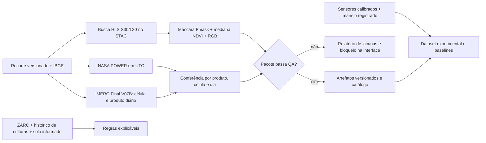
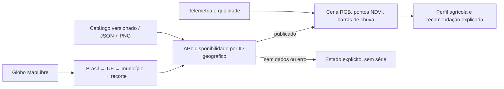
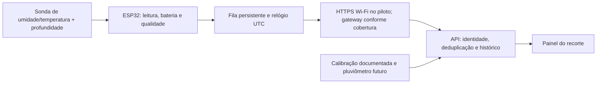

# Gaiapus — plano de execução do MVP | 14/11/2026

> **Estado do projeto:** a apresentação e o demonstrador estático são referências. O frontend e o backend da aplicação ainda serão criados. Para executar por etapa, use o [roteiro de implantação](2026-11-14-gaiapus-00-roteiro.md), que detalha telas, dados, contratos e critérios de aceite.

**Decisão do projeto:** Local Impact, começando pelo Triângulo Mineiro. Uberlândia é o piloto agronômico. Rio Verde (GO) e Barreiras (BA) testam se o fluxo de dados pode ser repetido fora do piloto. A competição mostra análise somente em recortes publicados no Brasil. O globo permite explorar outros países como primeira etapa de uma expansão futura.

**Primeira entrega da aplicação nova:** selecionar Brasil → UF → município → recorte, consultar um pacote conferido pela API, visualizar cena real, NDVI e chuva, e entender quando faltam dados. Em paralelo, obter uma amostra reproduzível das fontes agronômicas e preparar o simulador do sensor. Uma recomendação só entra se houver regra rastreável e entradas suficientes.

**Público inicial:** produtor familiar ou técnico de cooperativa com conexão limitada e uma área de interesse; o produtor com vários talhões reutiliza o mesmo fluxo. Medir durante o piloto se o usuário consegue localizar o recorte, diferenciar chuva regional de leitura de campo e explicar por que uma janela foi apresentada ou omitida.

## Ponto de partida

| Região | Janela UTC | Cenas HLS aceitas / consultadas | Dias de chuva POWER | Papel no MVP |
|---|---|---:|---:|---|
| Uberlândia (MG), IBGE 3170206 | 01/04–31/07/2024 | 51 / 64 | 122 | Piloto do Triângulo Mineiro |
| Rio Verde (GO), IBGE 5218805 | 01/06–31/07/2024 | 18 / 19 | 61 | Primeiro teste fora de MG |
| Barreiras (BA), IBGE 2903201 | 01/06–31/07/2024 | 16 / 19 | 61 | Segundo teste fora de MG |

São polígonos ilustrativos, não cadastros de propriedades. A competência geográfica para clicar em um município e a disponibilidade de análise para aquele município são independentes. O que está validado neste incremento é explicado no [relatório dos recortes](../../../data/README.md#recortes-demonstrativos-de-2024). As séries regionais são curtas; não permitem classificar cultivos nem medir degradação do solo.

- **Demonstrador estático de referência:** `gaiapus-mvp/`. React, MapLibre e arquivos estáticos. Para consultar a ideia visual, execute da raiz `bun gaiapus-mvp/build.cjs` e `python -m http.server 8765 --bind 127.0.0.1 --directory gaiapus-mvp`.
- **Ingestão:** `data/ingest/field_imagery.py`, `weather.py`, `imerg_ncar.py` e `imerg_monthly_reference.py`. Comece pelos dados já baixados.
- **Histórico:** `data/processed/uberlandia-2016-2024/`, 3.288 dias POWER e relatório de 108 comparações mensais. Esse ponto de referência de Uberlândia está em outra célula em relação ao recorte HLS. Não use a auditoria estadual/municipal como se fosse validação da célula do recorte.
- **Plano anterior:** [decisões do MVP e fontes](2026-11-13-gaiapus-plano-tecnico.md) e [fluxo do globo e HLS](2026-11-13-gaiapus-globo-ndvi.md).

## Ordem de trabalho de 14/11

Definam um responsável por trilha e um integrador que acompanhe os contratos. Horários abaixo são blocos de referência; o fim de cada bloco é uma entrega, não uma reunião longa.

| Bloco | Dados e IA | Aplicação | IoT |
|---|---|---|---|
| 09:00–09:40 · contrato | Fixar `field_id`, `dataset_version`, janela e regras de qualidade. Entregar um pacote válido e um deliberadamente inválido. | Definir JSON Schema/OpenAPI com Dados e IoT; executar o demo existente. | Validar payload, unidades, profundidade e plano de bancada. |
| 09:40–11:30 · trilhas paralelas | Reexecutar QA offline dos dados locais. Buscar e arquivar uma portaria/extração ZARC para o piloto, com todos os filtros da consulta. | Subir API local lendo os pacotes. Implementar `availability` e `observations`. Testar área sem cobertura e erro transitório. | Simular leitura e envio com `uv`; definir placa, sonda, profundidade e registro de calibração. |
| 11:30–12:00 · primeiro encaixe | Entregar versão e relatório ao integrador. | Front consome dados da API para Uberlândia e alterna para outro recorte sem recarregar o mapa. | Entregar duas mensagens, incluindo uma repetida, para ensaiar idempotência. |
| 13:30–15:30 · segunda fatia | Normalizar ZARC se a fonte estiver disponível; preparar uma recomendação explicável e um caso faltante. | Integrar recomendação ou estado “informação faltante”; mostrar origem e escopo da chuva. | Executar envio, perda de conexão e reenvio. Se houver sensor, documentar leitura bruta de bancada. |
| 15:30–17:00 · fechamento | Gerar relatórios QA e cartão do conjunto de dados; registrar quais exemplos têm rótulos reais. | Rodar cenário ponta a ponta no desktop e em viewport móvel. Congelar pacote para demo offline dos dados. | Entregar log de calibração/bench e lista de pendências para instalação. |

**Dependência crítica:** Dados e App concordam com a amostra e o esquema antes de construir o frontend; IoT não bloqueia o globo nem o histórico. Se o ZARC da safra/cultura não estiver disponível com origem verificável, o cartão deve listar a entrada faltante. Se o serviço de satélite falhar, use o último conjunto aprovado com data e versão visíveis.

## Trilha A — mineração, qualidade e IA



### A1. Catálogo, amostragem e aquisição — prioridade P0

| Fonte | Recorte e variáveis | Como obter e guardar | Uso e limite |
|---|---|---|---|
| [NASA HLS v2](https://hls.gsfc.nasa.gov/data-products/) via [Microsoft Planetary Computer](https://planetarycomputer.microsoft.com/dataset/group/hls2) | S30 (Sentinel-2 MSI) e L30 (Landsat 8/9 OLI), 30 m. Vermelho B04; NIR B8A (S30), B05 (L30); B04/B03/B02 para RGB; Fmask para qualidade. | Buscar STAC em `/api/stac/v1/search` com AOI, data e coleção. Paginar, deduplicar IDs, gravar metadados, ler janelas dos COGs com URLs assinadas no worker. Registrar IDs de cenas/ativos; não persistir SAS. | A reflectância é de superfície. NDVI é um indicador de vigor/cobertura, não identidade de cultivo, umidade, pH ou produtividade. |
| [NASA POWER Daily](https://power.larc.nasa.gov/docs/services/api/temporal/daily/) | `IMERG_PRECTOT`, `T2M_MIN`, `T2M_MAX`, `ALLSKY_SFC_SW_DWN`, histórico 2016–2024 onde houver necessidade. `time-standard=UTC`. | Query por pontos versionados, arquivar JSON original, parâmetros, timezone, checksum e a saída Parquet. Usar coordenadas e unidades devolvidas para QA, não presumir mesma resolução entre todas as variáveis. | Chuva estimada numa grade regional; não multiplicar evidência associando vários recortes da mesma célula. |
| [IMERG diário Final V07](https://doi.org/10.5067/GPM/IMERGDF/DAY/07), arquivos V07B | `precipitation` diário, célula de 0,1°, timestamp UTC. Separar de [IMERG mensal](https://doi.org/10.5067/GPM/IMERG/3B-MONTH/07). | Preferir NASA GES DISC/Earthdata ou o [espelho NCAR GDEX](https://gdex.ucar.edu/datasets/d734000/dataaccess/). Solicitar subset para a célula, guardar arquivo ou resposta, origem, versão e hash. | Conferência de consistência de distribuição, pois o POWER usa IMERG. O Final tem atraso de processamento; não oferecer “chuva agora”. Validação independente exige pluviômetro/estação e revisão de distância e horário. |
| [IBGE Malhas](https://servicodados.ibge.gov.br/api/docs/malhas?versao=4) | País/UF/município, códigos oficiais. | Guardar versão referenciada, simplificar para desenho e manter geometria original para validação. | Pertencer ao município não comprova uso agrícola nem propriedade. |
| [MAPA ZARC](https://www.gov.br/agricultura/pt-br/assuntos/riscos-seguro/programa-nacional-de-zoneamento-agricola-de-risco-climatico/portarias) e [SISZARC](https://www.gov.br/agricultura/pt-br/assuntos/riscos-seguro/programa-nacional-de-zoneamento-agricola-de-risco-climatico/siszarc) | Safra, UF, município, cultura, grupo/ciclo, condição de manejo/clima, classe de solo/AD e nível de risco, quando aplicáveis à portaria. | Baixar tabela/portaria e consolidar 1 linha por combinação e decêndio. Guardar URL, publicação, vigência, filtros, checksum e revisor. Começar por uma cultura e um município. | A janela apresentada só é válida com combinação e fonte identificadas. Oito dias de chuva ou NDVI atual não substituem o zoneamento. |
| Histórico local e solo | Cultura por safra; datas, sequeiro/irrigado, manejo, laudo de solo e profundidade. | Formulário consentido e revisão agronômica. Use mapas de solo para triagem apenas, com origem, resolução e incerteza. | Sem laudo/classe confirmada, listar dados a obter. NDVI e a sonda de umidade não inferem pH, NPK ou matéria orgânica. |

**Granularidade:** criar `fields` (AOI, IBGE, versão, origem), `acquisitions` por cena, `rain_daily` por célula, data UTC e run, `crop_windows` por combinação da fonte, `field_management` por talhão/safra e `sensor_observations` por dispositivo e timestamp. Preserve o bruto para explicar qualquer ponto do gráfico. Não processem o Brasil inteiro: testar recortes pequenos, limitar concorrência, controlar custo e medir tempo por AOI primeiro.

### A2. Limpeza, publicação e testes — P0

1. Fixar geometria de origem, CRS WGS84, ordem longitude/latitude, confirmação do município e área mínima operacional em pixels. Usar a célula de chuva do centro do recorte como referência amanhã e registrar se há sobreposição de outras células. Para talhões maiores, criar estratégia explícita de agregação e sinalizar no app.
2. Verificar grade, nodata e Fmask. A máscara atual exige bits 0–5 zerados; na documentação v2, as classes nuvem, adjacência, sombra, neve/gelo e água ficam nos bits 1–5. Excluir valores negativos e denominador não positivo. Aplicar escala/offset do produto quando existir; em HLS v2 com fator multiplicativo comum, a escala cancela no NDVI. Guardar contagem total, válida, proporção, data/ID e motivo de rejeição. Não preencher cena rejeitada com zero.
3. Calcular `(nir-red)/(nir+red)` por pixel e mediana no AOI; idealmente salvar também p25/p75. Mínimo de 65% de pixels válidos e três datas distintas para publicar série demonstrativa; é um critério do app, não um limiar agronômico. Distinguir aquisições sobrepostas no mesmo dia; para features diárias, deduplicar por regra escrita antes do treino.
4. Normalizar unidades de chuva, temperatura e radiação; preservação explícita de `null` e `0`. Verificar inclusive as datas de borda e o período anterior usado no acumulado móvel. Chuva de 7 dias para a cena do dia D soma D−7 a D−1. Marcar estimativa regional e fonte de cada variável.
5. Comparar POWER com o diário V07B por célula/data. Relatar dias esperados, pareados, ausentes em cada fonte, diferenças acima de 0,02 mm/dia, viés POWER menos referência, MAE e máximo absoluto. No demo, servimos os valores da referência diária V07B, quando a série está completa, e registramos divergências do POWER. Para janela mensal completa, comparar soma diária com produto mensal em outra coluna; converter taxa mensal conforme unidades e horas UTC. Se a origem da diferença não for conhecida, registre contexto e não force equivalência.
6. Manifesto de publicação: `schema_version`, `dataset_version`, AOI e CRS, intervalo, soma SHA-256 do bruto e do derivado, versão da ingestão, fontes e cenários de QA. A imagem RGB deve apontar para uma cena elegível, com URL, data, resolução e enquadramento. Distinguir `schema_passed`, `product_crosscheck`, `ground_check` e `published`; ausência de validação em campo deve ser visível. Na API, materializar e servir somente após QA; atualizações publicam um novo manifesto com troca atômica.
7. A amostra negativa do contrato deve conter data duplicada ou chuva faltante, ou três cenas no mesmo dia. A API deve omitir a disponibilidade/retornar erro claro e o app não pode exibir o pacote. Registrar perdas de dados por nuvem e indisponibilidade da fonte separadamente.

### A3. Motor de decisão primeiro; ML só com rótulo — P1/P2

**Entrega do MVP:** regras versionadas e revisão de agrônomo. Formulário coleta cultura, cultura anterior, classe de solo/AD, ciclo, data pretendida e irrigação. Filtrar primeiro as janelas ZARC com chaves completas; então apresentar possíveis rotações como hipóteses condicionadas ao histórico e ao objetivo (cobertura do solo, alternância de culturas ou manejo de pragas). Mostrar fonte, data, evidência usada, motivo e perguntas pendentes. Um exemplo candidato é sucessão de grão e cultura de cobertura após confirmação de janela, clima e objetivos; não prometer melhora do solo sem medir. Regras agrícolas não se propagam de MG para GO/BA.

**Experimento de aprendizado, após coleta:** prever umidade volumétrica a 24 h na mesma profundidade, com sondas calibradas, chuva e irrigação registradas. Alvo é leitura válida futura em `m³/m³` (não o valor bruto do ADC); opções de base são persistência e regressão regularizada. Se houver séries suficientemente longas de vários talhões e estações, comparar com árvore de boosting. Uma rede neural só faz sentido se houver dados em escala e ganho demonstrado. Os três recortes de 2024, sem sensor e rótulo, servem para testar ingestão e QA, não para treinar.

- Construir features com `event_at` e `available_at`, sempre anteriores ao instante da previsão, incluindo última leitura, temperatura do solo, chuva observável até o corte, janelas atrasadas, exposição solar quando disponível e tempo desde última cena NDVI. Para previsão operacional, nunca usar IMERG Final retroativo como se estivesse disponível em tempo real; usar a fonte operacional que será usada na inferência ou rotular o experimento como retrospectivo.
- Separar por fazenda/talhão **e** tempo; reservar áreas nunca vistas e período posterior. Bloquear sobreposição em bordas e na janela do alvo. Ajustar normalização, imputação e hiperparâmetros só nos folds de treino/validação. Reportar falta de eventos e dados por sítio/estação e comparação com as mesmas linhas do baseline.
- Medir MAE, RMSE e viés por sítio e horizonte; publicar erro em `m³/m³`, cobertura e tamanho da amostra. Meta inicial proposta: reduzir MAE em pelo menos 10% contra persistência no teste congelado, sem piora relevante de viés em um sítio. Se o benchmark não for conclusivo, mantenham o app com regras e contexto histórico. Não sugerir irrigação automática.
- Artefatos: dicionário de features, script de treino reproduzível com `uv`, `train/validation/test` com IDs congelados, relatório e ficha do modelo. O motor de regras tem teste de janela vigente, dado faltante, grupo/ciclo incorreto, mudança de safra e tratamento de área sem cobertura.

## Trilha B — frontend e backend



| Tarefa | Entrega | Critério |
|---|---|---|
| B1 · Navegação | Globe 3D global, Brasil, UFs IBGE, municípios com malha disponível, recortes. Teclado e botões equivalentes. Manter seleção ao voltar; movimento reduzido; versão móvel com painel abaixo. | Navegar por mapa e seletor; click em país fora do Brasil aproxima, mas não abre dados; UF/município sem dados não herda série. |
| B2 · API local | FastAPI + esquema Pydantic, catálogo em JSON a partir do manifesto; dados derivados em disco para a primeira integração. Servir apenas ativos publicados, dependência explícita do `dataset_version`. | Front obtém todos os valores pela API; recorte defeituoso não remove os demais. Não baixar rasters dentro de uma requisição do usuário. |
| B3 · Séries e proveniência | Cena RGB datada, polígono, porcentagem válida, data por ponto, chuva em mm/dia UTC e mesma escala temporal em dois painéis. Tabela acessível. | Conferir três pontos dos gráficos contra artefato. Não ligar lacunas; `0` e ausência têm representações distintas. Imagem local como fallback de WebGL. |
| B4 · Perfil e rotação | Formulário progressivo e cartão de justificativa/recomendação ou informações faltantes. | Seleção inicial não deduz solo ou cultura. Não exibir contador, clima ao vivo ou previsão inventada. |
| B5 · IoT | Última leitura com horário, profundidade, unidade e qualidade. Estado “sensor desatualizado” e sem coleta. | Interrupção de telemetria não altera o histórico de satélite e não vira valor zero. |

### Contrato de integração sugerido

| Rota | Entrada | Resposta/semântica |
|---|---|---|
| `GET /v1/availability?country=BR&uf=31&municipality_code=3170206` | UF/município opcionais, códigos string | `supported_country`, lista de recortes publicados (pode estar vazia), ID, caixa geográfica WGS84, revisão/intervalo e qualidade. País no contrato ISO alfa-2; converter alfa-3 da base do mapa na borda do frontend. |
| `GET /v1/fields/{id}/observations?from=2024-06-01&to=2024-07-31` | Datas UTC inclusivas | `field`, `image`, `observations[]`, `rainfall[]` (série publicada, com produto explícito), `validation`, `sources`. Retornar 404 para ID desconhecido ou indisponível, 422 para parâmetros inválidos e estado vazio explícito para janela válida sem dados. Publicação de uma temporada não autoriza apresentar a seguinte. |
| `POST /v1/fields/{id}/recommendations` | Safra, cultura, grupo, classe de solo/AD, irrigação, histórico e data, quando aplicável | `status: ready\|needs_input\|not_available`, `missing_fields`, `rule_version`, `options[]`, `evidence[]` e URL da portaria. |
| `POST /v1/telemetry` | Mensagem com autenticação por dispositivo | Recebimento com ID estável. Validação de esquema/unidade, associação dispositivo→recorte no servidor, deduplicação e armazenamento. |

```json
{
  "schema_version": "1.0.0",
  "field_id": "uberlandia",
  "country": "BR",
  "uf": "31",
  "municipality_code": "3170206",
  "dataset_version": "example-contract",
  "period": {"from": "2024-04-01", "to": "2024-07-31", "time_standard": "UTC"},
  "validation": {"status": "validated", "scope": "demo_product_quality", "ground_check": "not_checked"}
}
```

O JSON acima demonstra o envelope; valores observados vêm dos arquivos gerados. Campos de data no corpo são ISO 8601; o frontend formata em PT-BR sem deslocar um dia UTC. Use cache por `dataset_version`/ETag; nunca reutilize o payload pelo nome do município. Cancelar requisições pendentes ao trocar de recorte. Distinguir carregando, área ainda sem pacote, falha temporária, dados históricos e dados antigos do sensor. Se o mapa falhar, o seletor e a tabela continuam úteis. Para demo sem conexão externa, o pacote local mantém a análise acessível pelo seletor; o mapa base completo exige tiles locais ou rede.

**Fases posteriores:** banco geoespacial e armazenamento de objetos quando ingestão, usuários e atualizações concorrentes justificarem. Separar adaptador de limites, catálogo e regras por país. Um país pode ter dados do satélite e mesmo assim não ter regras locais ou pacote publicado. Manter WGS84, IDs estáveis, locale e unidades no contrato.

## Trilha C — dispositivo, piloto de campo e telemetria



- **Amanhã:** ESP32 em Rust `no_std` com `esp-hal`/Embassy se a bancada estiver pronta; começar pelo simulador aceito pela mesma rota. Sonda de umidade volumétrica e temperatura de solo em profundidade registrada; incluir bateria, estado e indicador de calibração. Ler a cada 15 min e enviar em lotes quando conectado. Uma leitura não representa todo o talhão; mapear zonas de manejo e instalar com consentimento.
- **Payload v1:** `device_id`, `boot_id`, `sequence`, `observed_at` UTC (ou marcar relógio inválido), `depth_cm`, `moisture_m3_m3`, `soil_temp_c`, `battery_mv`, `quality`, `calibration_id` e `firmware_version`. Guardar ADC bruto para depuração em bancada; se não calibrado, enviar umidade convertida como `null`. `received_at` gerado pelo backend. Reenvio mantém o mesmo ID; testar persistência em reinício.
- **Bancada:** medir repetibilidade em condições seca/úmida, documentar o substrato e comparar com referência apropriada; confirmar se geometria, profundidade e leitura são representativas. Antes do campo, avaliar vedação, autonomia e alcance. Testar desligamento, perda de conexão, fila cheia e reenvio, sem duplicar registros.
- **Distribuição:** um kit por zona de manejo na fase de campo, com assistência de cooperativa ou técnico, começando com um ponto demonstrativo consentido. Faça levantamento de linha de visada e cobertura antes de escolher LoRaWAN ou celular. Para fazenda grande, rede com gateway e zonas; para pequeno produtor, ponto inicial acessível. Custo por área e autonomia entram na decisão depois da bancada.

## Fechamento e critérios para mostrar à equipe

- [ ] O integrador consegue montar o ambiente do zero a partir dos comandos e amostras sem chaves salvas. Os dados brutos ficam reprodutíveis e a fonte de cada ativo aparece na interface.
- [ ] Abrir Uberlândia, Rio Verde e Barreiras; trocar entre eles e entrar em UF sem publicação. Conferir que a cena, data, número de observações e chuva realmente mudam. Repetir sem WebGL, em viewport móvel e usando teclado.
- [ ] Publicar lista de recortes com escopo e método da validação. Ter um caso negativo para dados faltantes e um caso de erro de rede. Não validar por aparência do gráfico.
- [ ] Apresentar uma janela de plantio com fonte/revisão ou mostrar explicitamente o que impede a sugestão. Não alegar ganho de rendimento, redução de erosão ou precisão sem experimento.
- [ ] Enviar duas leituras do simulador e repetir uma sem duplicar. Mostrar estado de calibração e profundidade.
- [ ] Redigir uma página de diário da execução: links das evidências, riscos que permaneceram e um responsável por ação pendente. Prioridade do dia seguinte: dados reais do primeiro piloto, corpus agronômico e parceiro de validação em campo.

**Roteiro de demonstração:** do globo a um recorte de Uberlândia; interpretar uma mudança na vegetação com a chuva no mesmo período e explicar suas escalas; abrir GO ou BA para demonstrar repetibilidade; abrir uma área sem análise para demonstrar o limite; finalizar com o que o sensor e a consulta ZARC acrescentam à decisão do agricultor.
