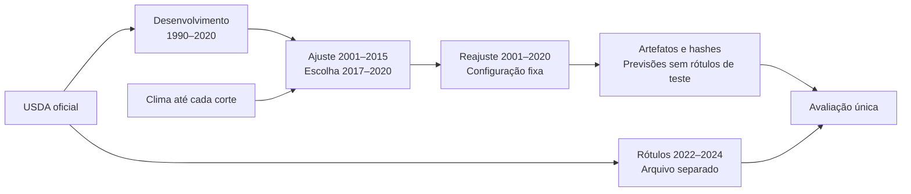

# Gaiapus — coleta USDA e treinamento EUA (IA/NE/KS)

> **Para o executor:** seguir `superpowers:executing-plans`, com testes de proteção antes de mudanças. Este plano já começou a ser executado pelo Codex em 15/11/2026. Não iniciar outra rodada concorrente. Conferir primeiro o relatório e os arquivos de congelamento existentes.

**Objetivo:** medir se modelos de rendimento de soja/milho em Iowa e Nebraska e trigo de inverno no Kansas superam referências locais, sem usar rótulos de teste na seleção, no preenchimento ou na normalização.

**Arquitetura:** experimento separado do Brasil, com recortes oficiais USDA, clima NASA POWER, geografia Census e cinco escopos estado × cultura. Desenvolvimento seleciona configurações; os artefatos finais geram todas as previsões antes da abertura dos rótulos de teste. A avaliação é retrospectiva e não altera modelos servidos.

**Stack:** Python, pandas, NumPy, scikit-learn, PyTorch/CUDA, pytest; arquivos CSV/JSON comprimidos e artefatos de pesquisa locais. A máquina tem RTX 4070 Ti disponível. Não é necessário hospedar a base de pesquisa no Supabase para executar este experimento.

**Especificação executável:** `data/frozen/us_training_v1_protocol.json`. O protocolo tem precedência sobre ajustes oportunistas após resultados. Alterações científicas posteriores exigem outra versão e uma avaliação independente apropriada.

## 1. Estado e escopo

O código desta rodada está em:

- `data/ingest/us_data.py`: filtro USDA, conversão, seleção de condados e histórico permitido;
- `data/ingest/us_features.py`: Census, POWER e features anteriores ao corte;
- `data/ingest/us_train.py`: referências, Ridge/HGB/MLP, congelamento, CPU e avaliação única;
- `tests/test_us_data.py`, `test_us_features.py`, `test_us_train.py`: invariantes e proteção contra vazamento;
- `data/frozen/us_training_v1_protocol.json`: decisões registradas antes de treinar.

O resultado efetivamente executado deve ser consultado em `docs/superpowers/plans/2026-11-15-gaiapus-eua-resultados.md`, quando presente. Não substituir resultados por estimativas narrativas ou por expectativas deste plano.

| Escopo | Cultura alvo | Unidade e escala |
|---|---|---|
| IA_soy | Soja em Iowa | kg/ha, média de county |
| IA_maize | Milho para grão em Iowa | kg/ha, média de county |
| NE_soy | Soja em Nebraska | kg/ha, média de county |
| NE_maize | Milho para grão em Nebraska | kg/ha, média de county |
| KS_wheat_winter | Trigo de inverno no Kansas | kg/ha, média de county |

Milho americano para grão não deve receber automaticamente o identificador de milho safrinha brasileiro. O experimento também não prevê produção total, margem, fenologia real ou resposta causal à irrigação. Esses produtos exigem outros contratos e dados.

## 2. Fontes oficiais e acesso

### USDA NASS: rendimento e variáveis auxiliares

Referências: [Quick Stats API](https://quickstats.nass.usda.gov/api), [arquivos oficiais para download](https://www.nass.usda.gov/datasets/index.php).

A API exige chave e retorna até 50 mil registros por consulta. Não havia chave USDA disponível no ambiente inspecionado. Para evitar bloquear o trabalho, esta execução usa o extrato público oficial `qs.crops_20261114.txt.gz`. O arquivo tem 1.132.713.258 bytes comprimidos; é lido em fluxo, descomprimido e filtrado. O arquivo nacional não é salvo no disco.

URL fixa usada: `https://www.nass.usda.gov/sites/default/files/datasets/qs.crops_20261114.txt.gz`.

Persistir somente registros compatíveis com:

- `source_desc=SURVEY`; não misturar com CENSUS;
- `agg_level_desc=COUNTY`, códigos ANSI válidos;
- estados IA/NE/KS;
- `freq_desc=ANNUAL`, `reference_period_desc=YEAR`;
- `domain_desc=TOTAL`, `domaincat_desc=NOT SPECIFIED`;
- `prodn_practice_desc=ALL PRODUCTION PRACTICES`;
- milho: CORN, ALL CLASSES, GRAIN;
- soja: SOYBEANS, ALL CLASSES, ALL UTILIZATION PRACTICES;
- trigo: WHEAT, WINTER, ALL UTILIZATION PRACTICES;
- alvo: YIELD, BU / ACRE.

Área plantada, área colhida e produção do desenvolvimento são armazenadas separadamente para auditoria e futuras análises. **Produção e área da própria safra não entram nas features**, pois podem revelar diretamente o alvo ou usar informação ainda indisponível na decisão.

Os recortes por prática irrigada/não irrigada não são contínuos para todos os anos. A página oficial do [Kansas](https://www.nass.usda.gov/Statistics_by_State/Kansas/Publications/County_Estimates/index.php) registra sua descontinuação em 2019. A primeira rodada trabalha com todas as práticas e declara essa limitação; não inventa um atributo anual de irrigação.

Se futuramente usar API, preferir consultas estado × cultura × ano e conferir contagens. Chave somente por ambiente, nunca em código, logs ou Git. Não enviar e-mail nem registrar conta automaticamente.

### NASA POWER: clima diário

Usar [POWER Daily API](https://power.larc.nasa.gov/docs/services/api/temporal/daily/) em `https://power.larc.nasa.gov/api/temporal/daily/point`:

- período 01/01/2000–31/12/2024;
- comunidade AG e `time-standard=UTC`;
- `PRECTOTCORR`, `T2M_MIN`, `T2M_MAX`, `ALLSKY_SFC_SW_DWN`, `RH2M`, `WS2M`;
- até três consultas simultâneas, retries limitados e cache com hash;
- pontos internos oficiais dos condados; suporte pontual, não média ponderada pela área da cultura.

Esta escolha é uma primeira base meteorológica reproduzível. `PRECTOTCORR` não deve ser rotulado como IMERG Late ou Final. A fonte e a variável precisam aparecer literalmente na documentação e nos metadados. IMERG, HLS/NDVI, irrigação e solo serão incrementos científicos posteriores, avaliados por ablação; não misturar novas fontes depois de observar o teste desta rodada.

### Census: geografia

Usar o [Gazetteer de 2024](https://www2.census.gov/geo/docs/maps-data/data/gazetteer/2024_Gazetteer/) para `GEOID`, `INTPTLAT`, `INTPTLONG` e nome. O ZIP nacional tem cerca de 138 KB e evita baixar geometrias pesadas apenas para obter coordenadas.

Identidade canônica: FIPS de cinco caracteres, preservando zeros à esquerda. Não fazer joins por nome. Excluir agregados “other/combined counties”; uma unidade agregada não recebe coordenada de um condado real.

## 3. Seleção geográfica sem olhar o teste

Selecionar 50 condados por estado. Elegibilidade usa somente rendimento observado em 2001–2015, exigindo pelo menos 12 safras; IA/NE devem ter esse histórico para soja e milho. A ordem é determinística por SHA-256, priorizando as âncoras escolhidas anteriormente:

- Iowa: Story, Boone, Marshall;
- Nebraska: York, Hamilton, Dawson;
- Kansas: Sumner, McPherson.

Dez condados por estado, escolhidos por outro hash e excluindo âncoras, ficam fora de todos os ajustes e da escolha de hiperparâmetros. Os outros 40 formam o domínio de treino daquele estado.

O histórico anterior publicado do condado reservado pode ser usado como entrada: o teste espacial mede transferência do modelo para condados não usados no ajuste **com histórico disponível**, não transferência para um local sem nenhum rendimento anterior.

Não substituir condados depois de ver que tiveram erro grande. Se faltar rótulo, documentar ausência; não transformá-la em rendimento zero nem inferir colheita inexistente.

## 4. Limpeza e cruzamento

### Rendimento

1. Preservar valor original, unidade, código de supressão e `load_time`.
2. `(D)`, `(Z)`, `(NA)`, vazio ou outros códigos não numéricos ficam sem alvo numérico nesta rodada. Não converter `(Z)` em zero exato.
3. Converter bushels/acre usando 56 lb/bu para milho e 60 lb/bu para soja/trigo, 0,45359237 kg/lb e 4.046,8564224 m²/acre. Referência: [USDA ERS, fatores de conversão](https://www.ers.usda.gov/media/7780/ah-697.pdf).
4. Chave única: FIPS × cultura × safra, após fixar programa/prática/domínio/unidade. Duplicidade gera erro para auditoria; não usar média ou “primeiro registro” silenciosamente.
5. Retirar alvos suprimidos do ajuste e contabilizar cobertura por estado/cultura/ano.
6. `load_time` representa inserção do registro, não necessariamente a primeira divulgação histórica. Não tratá-lo como prova de disponibilidade original.

### Clima

1. Converter a chave YYYYMMDD para data explícita UTC.
2. Rejeitar sentinelas, NaN/inf, chuva negativa, Tmin maior que Tmax, umidade fora de 0–100, vento ou radiação negativos.
3. Exigir todos os dias do intervalo de features; lacunas excluem a linha com motivo.
4. Não usar chuva zero para preencher ausência, nem interpolação que consulte dias posteriores ao corte.
5. Guardar unidade original da resposta POWER, hash, consulta, obtenção e disponibilidade histórica desconhecida.

### Feature row

Chave: FIPS × cultura × safra; há um corte por cultura nesta primeira rodada.

- soja: semeadura hipotética 20/05, 90 dias de clima;
- milho: semeadura hipotética 06/05, 90 dias;
- trigo de inverno: semeadura hipotética 02/10 do ano anterior, 180 dias.

O último dia incluído é `sowing_date + cutoff_days - 1`. Calendários são hipóteses regionais já documentadas no projeto; não são datas observadas de cada produtor nem fenologia estimada.

Três segmentos iguais anteriores ao corte produzem chuva acumulada, temperatura mínima/máxima média, umidade, vento, radiação, dias quentes acima de 32 °C, dias com Tmin abaixo de 0 °C, dias secos abaixo de 1 mm e maior sequência seca. Esses limiares são descritores, não uma declaração de dano agronômico universal.

Histórico: último rendimento permitido, média dos três últimos, média/trend da janela de dez anos, número de observações e idade do último valor. Acrescentar ano e coordenadas. Não usar identificador de condado como um número ordinal para o modelo.

## 5. Separação temporal e proteção do teste



Regras:

- Ajuste de seleção: 2001–2015; validação para escolha: 2017–2020; 2016 não é validação nem ajuste dessa seleção.
- Ajuste final: 2001–2020; teste: 2022–2024. 2021 não entra no treino final nem no teste.
- Pré-processamento e imputação são ajustados apenas nas linhas de treino daquele ajuste.
- Dez condados por estado nunca entram no ajuste nem na escolha.
- Histórico da própria linha usa no máximo ano-alvo menos dois, e ainda respeita teto 2015 na seleção e 2020 no teste.
- Todos os testes de 2022–2024 usam histórico até 2020. Nenhum rótulo de 2022 passa a ser lag de 2024 nesta avaliação fixa.
- Modelos, colunas, scalers, código, protocolo e previsões são hasheados antes de abrir os rótulos.
- A etapa `score` exige todos os escopos congelados e grava `test_score.json` com criação exclusiva; uma segunda pontuação é recusada.
- Antes de abrir os rótulos, criar exclusivamente `test_consumed.json`. Treino e nova avaliação ficam bloqueados mesmo que ocorra uma interrupção antes de escrever `test_score.json`. Recuperação técnica exige as mesmas previsões congeladas, sem nova escolha.

**Limite científico:** extratos atuais podem conter revisões posteriores. O atraso de dois anos é uma proteção de desenho, não comprovação de que a revisão usada existia na data da decisão. A rodada é retrospectiva. Durante a busca de fontes, snippets públicos exibiram alguns rendimentos de Iowa de 2023/2024 e dois de 2025; essa exposição foi registrada antes do treino. Nenhum score de modelo EUA foi usado para escolher o protocolo. Não chamar o teste de totalmente cego nem fazer alegação de validação prospectiva.

## 6. Modelos e seleção

Para cada um dos cinco escopos, comparar:

| Método | Papel |
|---|---|
| Último rendimento permitido | Referência simples |
| Média dos três últimos permitidos | Referência simples |
| Tendência local calculada apenas do passado | Referência simples |
| Ridge de histórico/ano | Referência ajustada |
| Ridge com clima + histórico | Candidato linear |
| HistGradientBoosting com resíduo do Ridge histórico | Candidato não linear |
| MLP com resíduo do Ridge histórico | Candidato neural |

Busca pré-definida:

- Ridge: alpha 10 e 100; referência histórica alpha 10;
- HGB: 7 ou 15 folhas, 200 iterações, learning rate 0,05, mínimo 20 amostras/folha;
- MLP: camadas [32,16] ou [64,32], dropout 0,1, AdamW, learning rate 0,001, weight decay 0,01, batch 256;
- MLP: resíduo padronizado, MSE, até 250 épocas, paciência 25, semente 42 na escolha;
- Reajuste final MLP: épocas fixadas na validação, sementes 101/102/103 e média das previsões;
- GPU obrigatória para o MLP, com teste de forward/backward/update real e log de dispositivo/VRAM;
- previsões negativas são limitadas a zero por regra comum pré-definida.

Escolher por MAE médio por condado na validação dos condados de treino. Se a referência vencer, ela continua a escolhida; não promover o MLP por ser uma rede neural. Congelar também o melhor de cada família para comparação secundária no teste, sem trocar o escolhido depois de olhar os resultados.

O dataset é tabular e pequeno. Rede maior, mais VRAM ou mais épocas não demonstram ganho; aumentos exigem outra hipótese e outra avaliação.

## 7. Validação e interpretação

Relatar MAE/RMSE/viés em kg/ha, MAE dividido pelo rendimento médio e R² quando definido. Não transformar automaticamente `1 − erro percentual` em “acurácia”.

Separar:

- escopo estado × cultura;
- anos 2022, 2023 e 2024;
- condados usados no treino versus reserva espacial;
- quantidade de previsões, rótulos disponíveis e ausentes;
- candidato escolhido versus cada referência.

Bootstrap pareado por condado, 2.000 reamostragens, semente 42. Mostrar IC95% descritivo e limite superior com correção Bonferroni para cinco escopos × quatro referências. O intervalo é condicionado aos três anos observados; não representa toda variabilidade climática futura. Safras do mesmo condado não são tratadas como observações independentes no bootstrap.

Critério de confirmação retrospectiva da rodada: escolhido não é uma referência, ganho de pelo menos 5% contra todas as referências nos condados conhecidos, limite superior ajustado abaixo de zero, ausência de piora espacial e pelo menos 30 pares county–safra em cada conjunto. Resultados insuficientes permanecem inconclusivos, mesmo com baixo erro médio.

Nenhum resultado desta rodada vira aprovação operacional. O modelo brasileiro não é sobrescrito; o catálogo de serving e o registro prospectivo continuam intactos.

## 8. Arquivos, armazenamento e inferência CPU

```text
data/raw/us_training_v1/
  manifest.json
  development.jsonl.gz
  sealed_test.jsonl.gz
  ancillary.jsonl.gz
  census_counties_2024.zip
  census_manifest.json
  power/<FIPS>.json.gz
  power/<FIPS>.manifest.json

data/processed/us_training_v1/
  counties.json
  weather_progress.json
  selection.csv.gz
  final_fit.csv.gz
  test_inputs.csv.gz
  feature_manifest.json
  <escopo>/freeze.json
  <escopo>/test_predictions.csv
  all_frozen.json
  test_score.json

data/models/research_us_v1/
  <escopo>_references.joblib
  <escopo>_ridge.joblib
  <escopo>_hgb.joblib
  <escopo>_mlp.joblib
  <escopo>_mlp.pt
```

Joblib é artefato de pesquisa confiável gerado localmente, dependente das versões do ambiente. Nunca carregar arquivo joblib recebido de origem desconhecida. Os pesos MLP também são salvos separadamente como state_dict em CPU. O pipeline exportado inclui ordem das colunas, imputer, scaler, modelo de referência e escala do resíduo; pesos sozinhos não bastam para inferência correta.

A previsão final salva é feita pela implementação CPU, comparada com a mesma rede em CUDA. Diferença máxima permitida: 0,05 kg/ha, tolerância numérica, não margem de erro científico.

Brutos, processados e modelos seguem as regras de exclusão do Git já existentes. Publicar apenas código, protocolo, documentação e relatórios pequenos; modelos podem ir para uma release específica depois de revisão. Não subir histórico nacional, dados privados ou credenciais.

Na primeira coleta, os recortes USDA ocuparam aproximadamente 1,5 MB; os 150 arquivos climáticos e metadados levaram o conjunto bruto a cerca de 37,6 MB. O relatório final deve trazer tamanho atualizado. A autorização de 200 GB é teto, não meta de consumo.

## 9. Execução e retomada

Na raiz do repositório científico, usar o ambiente Python já configurado com CUDA. Não substituir o PyTorch instalado por uma versão CPU. Se criar ambiente novo, usar uv e registrar versões.

```powershell
python -m pytest tests/test_us_data.py tests/test_us_features.py tests/test_us_train.py -q
python -u -m data.ingest.us_data collect
python -m data.ingest.us_data select
python -u -m data.ingest.us_features collect
python -u -m data.ingest.us_features build
python -u -m data.ingest.us_train train
python -u -m data.ingest.us_train score
```

**Não execute essa lista cegamente.** Se a rodada já terminou, leia o resultado. A coleta reutiliza arquivos verificados; o treinamento retoma escopos congelados apenas se hashes coincidirem. Reconstruir datasets/modelos de uma rodada avaliada pode invalidar a evidência, mesmo que o score não seja regravado.

Se houver falha de rede: retomar coleta sem alterar seleção. Se houver falha técnica antes de qualquer score e depois de algum congelamento: diagnosticar, documentar e criar uma revisão técnica coerente de todos os artefatos afetados, sem abrir o teste. Depois do teste, qualquer nova escolha científica pertence a outra versão e não pode reutilizar 2022–2024 como confirmação independente.

### Checklist de entrega

- [x] Protocolo antes do treino e exposição prévia documentada.
- [x] Extração oficial e recortes em disco, sem arquivo nacional persistido.
- [x] 150 condados selecionados usando apenas desenvolvimento.
- [x] Clima coletado com metadados e hashes.
- [x] Features e exclusões auditadas.
- [x] Referências, Ridge, HGB e MLP treinados.
- [x] Paridade CPU/CUDA e artefatos congelados.
- [x] Avaliação única, cobertura e intervalos publicados no relatório local.
- [x] Testes finais e resumo de limitações: 45 testes passaram; nenhum escopo teve ganho confirmado.

## 10. Próximas melhorias, sem contaminar esta avaliação

Após a rodada, preservar seu resultado e abrir protocolo novo para:

1. Clima ponderado pela área cultivada, usando máscara de cultura anual disponível no corte; nunca máscara futura para prever passado.
2. Irrigação do Nebraska com fonte/ano/prática auditados; ausência não equivale a sequeiro.
3. Solo e capacidade de água útil com qualidade e profundidade, sem estimar precisão de talhão a partir de média de county.
4. Fenologia/calendários locais observados ou modelos revisados, especialmente dormência/vernalização do trigo.
5. NDVI/HLS limitado ao corte e mascarado por qualidade, com teste de ganho sobre clima/histórico.
6. Chuva operacional e datas históricas de divulgação, medindo o desvio entre produto final e produto disponível na decisão.
7. Mais condados e validação temporal em anos realmente não usados para escolhas.
8. Registro prospectivo antes dos novos cortes e posterior comparação com a primeira divulgação USDA correspondente.

Não adicionar tudo simultaneamente. Uma ablação por fonte mostra se ela melhora a previsão ou apenas aumenta armazenamento e complexidade.

## Prompt curto para o Claude

```text
Leia docs/superpowers/plans/2026-11-15-gaiapus-eua-usda-treinamento.md, docs/superpowers/plans/2026-11-15-gaiapus-eua-resultados.md e data/frozen/us_training_v1_protocol.json. O Codex já coletou, treinou na GPU e avaliou a rodada; nenhum escopo confirmou ganho. Audite os artefatos e planeje a próxima versão. Preserve hashes, modelos e resultados congelados. Não refaça seleção nem reutilize 2022–2024 como teste independente. Melhorias precisam de novo protocolo e outra confirmação elegível. Priorize cobertura de rótulos, clima por área cultivada, irrigação do Nebraska e calendário do trigo, sem alterar os modelos brasileiros ou promover modelos EUA automaticamente.
```
