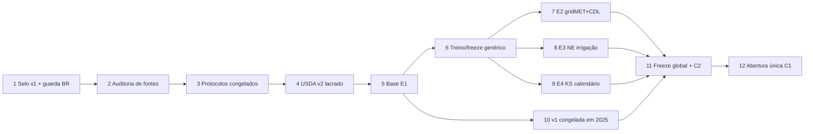

# Gaiapus EUA v2 — auditoria da v1 e plano de experimentos separados

> **For agentic workers:** REQUIRED SUB-SKILL: Use superpowers:subagent-driven-development (recommended) or superpowers:executing-plans to implement this plan task-by-task. Steps use checkbox (`- [ ]`) syntax for tracking.

**Goal:** testar, em experimentos separados e pré-registrados, se cobertura de rótulos, clima ponderado por área cultivada, irrigação do Nebraska e calendário do trigo melhoram a previsão de rendimento por condado nos EUA, com confirmação em safras nunca usadas em escolhas.

**Architecture:** a v1 fica selada e somente leitura. A v2 tem um protocolo guarda-chuva e um protocolo por experimento (E1–E4), todos congelados antes de qualquer resultado de modelo v2. Desenvolvimento usa rótulos 1990–2024 com validação temporal rolante; a confirmação C1 (safra 2025, lacrada na extração) é aberta uma única vez depois que todos os experimentos congelarem; C2 (safra 2026) é registro prospectivo antes da divulgação USDA.

**Tech Stack:** Python 3.13 (`C:\Python313\python.exe`, torch 2.11.0+cu128), pandas, NumPy, scikit-learn, PyTorch/CUDA, pytest. Novos módulos `data/ingest/us_v2_*.py`.

**Spec:** este documento + [resultados v1](2026-11-15-gaiapus-eua-resultados.md) + [plano v1](2026-11-15-gaiapus-eua-usda-treinamento.md) + `data/frozen/us_training_v1_protocol.json`.

---

## 0. Auditoria da v1 (executada em 15/11/2026, somente leitura)

### 0.1 Integridade — OK

| Verificação | Resultado |
|---|---|
| SHA-256 do protocolo | `60f40fc6…7f096d` — confere com relatório, `all_frozen.json`, `test_consumed.json` e cada `freeze.json` |
| SHA-256 do score | `97689340…45ddc81` — confere |
| Hashes de código no `freeze.json` | `us_data.py`, `us_features.py`, `us_train.py`, `gpu.py` conferem com os arquivos atuais |
| Marcador de teste | `test_consumed.json` criado 13:05:04Z, depois de `all_frozen.json` (13:04:01Z) — ordem correta |
| Artefatos | 5 escopos × (freeze + previsões); 25 arquivos de modelo em `data/models/research_us_v1/` |
| Testes v1 | 28/28 passam. 3 falham só com o `basetemp` padrão no sandbox (`PermissionError` em `pytest-of-leand`); com `--basetemp` no scratchpad passam |

### 0.2 Riscos de preservação

1. **Código, protocolo e docs da v1 não estão no Git** (`git status`: `us_data.py`, `us_features.py`, `us_train.py`, protocolo, testes e relatórios aparecem como `??`). Os artefatos em `data/raw|processed|models` são ignorados pelo `.gitignore`. Hoje a única cópia está no OneDrive.
2. `data/ingest/gpu.py` é rastreado e está hasheado nos freezes da v1. **Qualquer edição nele quebra a reverificação da v1.** O mesmo vale para os três módulos `us_*.py`.

> **Revisão de 15/11/2026 (substitui decisões deste documento onde houver conflito):** o protocolo executável é `data/frozen/us_training_v2_protocol.json` + `us_training_v2_selection_addendum.json` + `us_v2_availability.json`. Mudanças: (1) o descompasso abaixo é **hipótese testada por ablação** (E1a disponibilidade × defasagem fixa; diagnóstico v1-style), não causa comprovada; (2) regra `available_at <= issued_at` no lugar de defasagem fixa; (3) E1 separado em disponibilidade (E1a) e ampliação de condados (E1b), mesmas chaves e população; (4) irrigação NE limitada ao recorte por prática até 2018 (descontinuado em 2019); trigo KS 2024 por condado não existe; (5) família de 53 comparações; (6) radiação POWER excluída por latência de 75 dias; (7) cenários 2027/2028 via `data/forecasting/weather_ensemble.py`.

### 0.3 Hipótese principal — descompasso de defasagem do histórico

`history_features` usa `ceiling = min(target_year − 2, teto_fixo)`. No ajuste (2001–2015) o teto fixo quase nunca atua; na validação (teto 2015) e no teste (teto 2020), atua sempre:

| Conjunto | `hist_age` = 2 | 3 | 4 | 5+ |
|---|---:|---:|---:|---:|
| Ajuste de seleção (≤2015) | 3.668 | 12 | 1 | 0 |
| Validação (2017–2020) | 198 | 213 | 190 | 256 |
| Ajuste final (2001–2020) | 4.676 | 64 | 19 | 10 |
| Teste 2022 / 2023 / 2024 | 233 / 0 / 0 | 15 / 233 / 0 | 1 / 15 / 233 | — |

Os modelos aprendem quase só com defasagem 2 e são avaliados com 2–5. Além disso, a janela `target_year − 10` encolhe quando o teto atua (`hist_count` e `hist_mean10` mudam de distribuição). Sinais compatíveis (não prova de causa): MLP com melhor época = 1 em IA_maize e KS_wheat_winter; `history_ridge` com MAE de validação 2.248 kg/ha em IA_maize contra 942 do `last`; referências simples vencendo os aprendidos. Outras explicações possíveis (derecho de 2020 em Iowa, clima pontual pouco representativo, irrigação) não foram excluídas. **Isso não invalida a v1** (o desenho foi pré-registrado e cumprido); a v2 testa a hipótese por ablação.

### 0.4 Cobertura de rótulos — queda já visível no desenvolvimento

Rótulos observados por ano entre os 50 condados selecionados (ajuste final):

| Ano | IA milho | NE milho | IA soja | NE soja | KS trigo |
|---|---:|---:|---:|---:|---:|
| 2012 | 50 | 49 | 50 | 49 | 46 |
| 2015 | 47 | 44 | 49 | 40 | 38 |
| 2018 | 49 | 43 | 49 | 39 | 32 |
| 2019 | 46 | 44 | 44 | 35 | 27 |
| 2020 | 48 | 50 | 44 | 47 | 44 |

A elegibilidade v1 olhava só 2001–2015. Com reserva espacial de 10 condados × 3 anos, nenhum escopo alcançou 30 pares espaciais. KS teve 74 de 150 rótulos de teste ausentes.

### 0.5 Outras limitações confirmadas

- Clima POWER (grade ~0,5°) no ponto interno do condado: ponderar por área cultivada dentro dessa grade quase não muda o valor. Clima ponderado exige grade fina.
- NE mistura irrigado e sequeiro no alvo "ALL PRODUCTION PRACTICES"; o recorte `ancillary` só guardou essa prática.
- Trigo: semeadura fixa 02/10 + 180 dias termina ~30/03; inclui dormência e exclui espigamento/enchimento.
- Exposição documentada: snippets com rendimentos de Iowa 2023/2024 e **dois valores de Iowa 2025**.
- Memória Graphiti indisponível nesta sessão (ferramentas `mcp__graphiti__*` ausentes); não há decisão anterior registrada lá a citar.

---

## Global Constraints

- v1 é somente leitura: nada em `data/raw/us_training_v1/`, `data/processed/us_training_v1/`, `data/models/research_us_v1/`, `data/frozen/us_training_v1_protocol.json`, `data/ingest/us_data.py`, `us_features.py`, `us_train.py`, `gpu.py` e `tests/test_us_*.py` pode ser editado, movido ou regravado. Importar funções da v1 é permitido.
- 2022–2024 são **desenvolvimento** na v2 (flag `seen_in_v1_test=true`), nunca confirmação.
- 2021 nunca foi lido na v1; entra no desenvolvimento v2 (usá-lo como confirmação quebraria a cadeia de histórico de 2023+).
- Confirmação C1 = safra 2025, todos os escopos; C2 = safra 2026, registro prospectivo. IA 2025 carrega a marca `exposure_qualified` (dois valores vistos).
- Rótulos de confirmação: gravados em `sealed_confirmation.jsonl.gz` sem imprimir valores, sem log por linha, sem leitura por código de features/treino até a abertura.
- Regra de defasagem: `lag = 2` anos para treino, validação e confirmação (`ceiling = target_year − 2`, sem teto fixo). Mudar para `lag = 1` é outro experimento futuro.
- Grades de modelo idênticas à v1 (Ridge alpha 10/100; HGB 7/15 folhas, 200 iter., lr 0,05, min leaf 20; MLP [32,16]/[64,32], dropout 0,1, AdamW lr 1e-3, wd 1e-2, batch 256, paciência 25, sementes 42 e 101/102/103). A v2 mede dados, não arquitetura.
- Família de comparações para Bonferroni: 28 (E1: 5 escopos × 4 referências; E2: 5; E3: 2; E4: 1).
- Critério de confirmação por comparação: ganho ≥5% de MAE, limite superior ajustado < 0 (bootstrap pareado por condado, 2.000 reamostragens, semente 42), sem piora na reserva espacial, ≥30 pares em cada conjunto. Escopo com menos de 30 pares esperados fica `underpowered` **antes** da abertura.
- Não alterar modelos, protocolos, registro prospectivo ou catálogo brasileiros. Nenhum modelo EUA é promovido; status máximo `research_confirmed`.
- Orçamento: disco novo ≤200 GB; rede ≤60 GB (gridMET por recorte); nenhum arquivo nacional persistido.
- Sem `.env`/segredos no código; chave USDA (se usada) só por variável de ambiente.
- Commits locais só com autorização do Leandro; nunca push.

## Review Focus

1. **Vazamento da confirmação por caminho indireto** (log, contagem por condado, `describe()` em DataFrame com 2025) — esperado: só contagens agregadas estado×cultura saem do extrator. Teste em Task 4.
2. **Máscara de cultura do futuro** (CDL do ano Y usada para o ano Y) — esperado: só CDL `Y−1` ou anterior, e erro se ausente. Teste em Task 7.
3. **Ausência de prática irrigada tratada como sequeiro** — esperado: `NaN` + indicador, nunca 0. Teste em Task 8.
4. **Datas de semeadura derivadas de relatório publicado depois do corte** — esperado: só semanas com data de divulgação ≤ corte. Teste em Task 9.
5. **Regravar algo da v1 ao reaproveitar cache POWER** — esperado: cópia para diretório v2 com hash conferido; selo v1 continua válido. Teste em Task 1 executado de novo ao final (Task 12).

---

## Experimentos

| Id | Hipótese | Braço | Comparação primária | Escopos |
|---|---|---|---|---|
| E1 (base v2) | Corrigir defasagem + universo de condados com cobertura recente melhora sobre referências | `base` | base × `last`, `mean3`, `trend`, `history_ridge` | 5 |
| E2 | Clima em grade fina ponderado pela área da cultura (CDL Y−1) melhora sobre o mesmo clima no ponto | `gridmet_cdl` | `gridmet_cdl` × `gridmet_point` (ambos sobre a base) | 5 |
| E3 | Fração irrigada defasada + exposição climática do sequeiro melhora NE | `ne_irrigation` | `ne_irrigation` × `base` | NE_soy, NE_maize |
| E4 | Janela ancorada na semeadura observada do ano (Crop Progress) + descritores de vernalização/inverno melhora KS no mesmo corte | `ks_phenology` | `ks_phenology` × `base` | KS_wheat_winter |

Exploratórios, fora da família de 28: `gridmet_cdl` × POWER base; v1 congelados aplicados a 2025 com o código v1 (sem retreino); KS com corte tardio 15/05.

---

### Task 1: Selar v1 e guardar artefatos brasileiros

**Files:**
- Create: `scripts/us_v1_seal.py`, `data/frozen/us_training_v1_seal.json`
- Test: `tests/test_us_v1_seal.py`

**Interfaces:**
- Produces: `build_seal(root: Path) -> dict` com `{"v1": {relpath: sha256}, "br_guard": {relpath: sha256}, "created_at": str}`; `verify_seal(root: Path, seal: dict) -> list[str]` (lista de divergências, vazia = OK).
- `v1` cobre todo arquivo sob os três diretórios v1 + protocolo + `data/ingest/{us_data,us_features,us_train,gpu}.py` + `tests/test_us_*.py` + os dois relatórios v1.
- `br_guard` cobre `data/frozen/{training_v8_protocol,training_v9_protocol,prospective_v9_protocol,test_2022_2024_v7,v8_frozen_choices,regional_rule_soy_mg_mt_g30,source_availability_v9}.json`, `prospective_v9_protocol_versions.jsonl` e todo arquivo de modelo BR servido (diretórios listados pelo catálogo de serving existente).

- [ ] **Step 1:** Teste `test_seal_detects_change`: em `tmp_path`, seal de dois arquivos; alterar um byte → `verify_seal` retorna `[relpath]`. Teste `test_seal_is_create_once`: segunda escrita do JSON de selo levanta `FileExistsError` (abrir com modo `'x'`).
- [ ] **Step 2:** `pytest tests/test_us_v1_seal.py -q --basetemp=<scratchpad>/pyt` → FAIL (módulo ausente).
- [ ] **Step 3:** Implementar; antes de gravar, `build_seal` confere protocolo `60f40fc6fd0f9feade9adfb392618923c79531bfe68bb640af812118ab7f096d` e score `97689340eb5ea9769d65b98598ba2248f3d071eb124280375c61f171b45ddc81`; se divergir, aborta.
- [ ] **Step 4:** Rodar `python scripts/us_v1_seal.py write` uma vez; depois `test_current_tree_matches_seal` (lê o selo real e espera `[]`). PASS.
- [ ] **Step 5:** Pedir autorização ao Leandro para commit **local** dos arquivos v1 hoje não rastreados (código, protocolo, testes, relatórios, `report_us_training.py`) + selo. Mensagem: `chore(us-v1): track frozen v1 code, protocol and seal`.

### Task 2: Auditoria de fontes sem rótulos de confirmação

**Files:**
- Create: `scripts/us_v2_source_audit.py`, saída `data/processed/us_training_v2/source_audit.json`
- Test: `tests/test_us_v2_source_audit.py`

**Interfaces:**
- Produces: `source_audit.json` com chaves `nass_county_coverage` (estado×cultura×ano 2001–2024, contagem publicada), `nass_confirmation_presence` (estado×cultura para 2025 e 2026: `n_numeric`, `n_suppressed`, sem FIPS e sem valores), `ne_practice_coverage` (NE soja/milho × prática IRRIGATED/NON-IRRIGATED × ano ≤2024: condados com YIELD e com AREA HARVESTED), `ks_crop_progress` (anos com série semanal "PCT PLANTED" de trigo de inverno KS e granularidade estado/distrito), `district_aggregates` (contagem de "OTHER (COMBINED) COUNTIES" por ano), `cdl_years` (primeiro ano CDL por estado), `gridmet_subset_ok` (bool + URL testada), `release_dates` (data de divulgação das estimativas por condado USDA 2025/2026 e da CDL, com URL de fonte).
- `release_dates` e `cdl_years` são preenchidos a partir de documentação oficial com URL; não presumir.

- [ ] **Step 1:** Teste `test_confirmation_presence_has_no_values`: alimentar o extrator com linhas sintéticas 2025 (`Value="187.5"`, FIPS) → saída contém só `n_numeric`/`n_suppressed` por estado×cultura; `"187.5"` e o FIPS não aparecem no JSON serializado.
- [ ] **Step 2:** Rodar → FAIL.
- [ ] **Step 3:** Implementar lendo o extrato nacional mais recente em fluxo (mesmos filtros de programa/geografia/unidade da v1 + práticas NE + estatística PROGRESS para KS). Nada nacional persistido.
- [ ] **Step 4:** Rodar teste → PASS; rodar o script real e revisar o JSON.
- [ ] **Step 5:** Gate manual: se KS 2026 já tiver `n_numeric > 0`, KS 2026 entra em C1 (lacrado, retrospectivo não visto); senão vai para C2. Registrar a decisão no protocolo (Task 3).

### Task 3: Congelar protocolos v2

**Files:**
- Create: `data/frozen/us_training_v2_protocol.json` (guarda-chuva), `data/frozen/us_v2_e1_base.json`, `us_v2_e2_gridmet_cdl.json`, `us_v2_e3_ne_irrigation.json`, `us_v2_e4_ks_phenology.json`
- Test: `tests/test_us_v2_protocol.py`

**Interfaces:**
- Guarda-chuva contém: `development_label_years: [1990, 2024]`, `seen_in_v1_test: [2022, 2023, 2024]`, `confirmation: {"C1": {"years": [2025] + KS 2026 se aplicável, "exposure_qualified": {"IA": 2025}}, "C2": {"years": [2026], "kind": "prospective", "freeze_before": <data de release da Task 2>}}`, `lag_years: 2`, `history_window_years: 10` (ancorada em `ceiling`), `validation_years: [2016..2024]` (origem rolante; ajuste em anos ≤ V−2), `final_fit_target_years: {"C1": [2001, 2023], "C2": [2001, 2024]}`, `county_eligibility: {"min_obs_2001_2024": 12, "min_published_2020_2024": 3, "both_crops_IA_NE": true, "cap": null}`, `spatial_holdout: {"fraction": 0.2, "ranking": "sha256(us_training_v2:spatial:FIPS)", "exclude_anchors": true}`, `power_rule` (pares esperados = Σ taxa de publicação 2022–2024 do condado × anos de confirmação; <30 → `underpowered`), `model_grid` (cópia literal da v1), `family_size: 28`, `confirmation_rule` (Global Constraints), `exploratory` (lista), `sha256` de cada protocolo de experimento, `v1_seal_sha256`.
- Cada protocolo de experimento contém: hipótese, braços, comparação primária, escopos, fontes com URL e versão, regras de disponibilidade no corte, features novas com fórmula e limiar com citação, e o que é proibido.
- E4 fixa limiares de vernalização/frio com referência bibliográfica escrita no JSON; sem referência, a feature sai do protocolo.

- [ ] **Step 1:** Testes: `test_confirmation_disjoint_from_development` (nenhum ano de C1/C2 em `development_label_years` nem em `validation_years`); `test_family_size_matches_comparisons` (soma das comparações primárias = 28); `test_model_grid_equals_v1` (igual ao bloco `candidates` da v1 exceto chaves de seleção); `test_experiment_hashes_match` (hashes no guarda-chuva = arquivos).
- [ ] **Step 2:** Rodar → FAIL.
- [ ] **Step 3:** Escrever os cinco JSONs com os valores acima e da Task 2.
- [ ] **Step 4:** Rodar → PASS.
- [ ] **Step 5:** Commit local (com autorização): `docs(us-v2): register umbrella and E1–E4 protocols before any v2 model`.

### Task 4: Extração USDA v2 com confirmação lacrada

**Files:**
- Create: `data/ingest/us_v2_data.py`; saídas em `data/raw/us_training_v2/` (`development.jsonl.gz`, `sealed_confirmation.jsonl.gz`, `ne_practice.jsonl.gz`, `ks_progress.jsonl.gz`, `manifest.json`)
- Test: `tests/test_us_v2_data.py`

**Interfaces:**
- Consumes: `data.ingest.us_data.normalize_record` por import, se ele não filtrar pelos anos da v1 (`split_name` usa os anos v1 — não reutilizar); caso filtre, reimplementar a conversão bu/acre → kg/ha e a supressão com teste `test_conversion_equals_v1` comparando com `normalize_record` em registros de 2010; protocolo v2.
- Produces: `route_record(record: dict, protocol: dict) -> Literal["development", "sealed", "drop"]`; `load_development() -> pd.DataFrame` (colunas da v1 + `seen_in_v1_test: bool`); `select_counties_v2(dev: pd.DataFrame) -> pd.DataFrame` (`fips, state, spatial_holdout, expected_confirmation_pairs`). Não existe função que leia `sealed_confirmation` fora de `score_once` (Task 12).

- [ ] **Step 1:** Testes: `test_route_2025_is_sealed`, `test_route_2021_is_development`; `test_extractor_never_prints_sealed` (capturar stdout/stderr com `capsys` numa extração sintética: nenhum valor 2025 aparece); `test_sealed_not_importable_by_features` (grep estático: `sealed_confirmation` só aparece em `us_v2_data.py` e `us_v2_train.py::score_once`); `test_duplicate_key_raises`; `test_suppressed_is_missing_not_zero`; `test_eligibility_uses_presence_only` (mudar valores 2020–2024 sem mudar presença não altera seleção).
- [ ] **Step 2:** Rodar → FAIL.
- [ ] **Step 3:** Implementar. Reserva espacial e âncoras como no protocolo v2.
- [ ] **Step 4:** Rodar testes → PASS; executar coleta real; conferir `manifest.json` (hashes, contagens agregadas, tamanho).
- [ ] **Step 5:** Commit local.

### Task 5: Base v2 (E1) — histórico com defasagem consistente

**Files:**
- Create: `data/ingest/us_v2_features.py`
- Test: `tests/test_us_v2_features.py`

**Interfaces:**
- Produces: `history_features_v2(history: pd.DataFrame, target_year: int, lag: int, window: int) -> dict` (mesmas chaves da v1; `ceiling = target_year − lag`; janela `[ceiling − window + 1, ceiling]`); `rolling_splits(frame, validation_years: list[int], lag: int) -> Iterator[tuple[int, pd.DataFrame, pd.DataFrame]]` (fit = targets ≤ V − lag, fora da reserva espacial; val = ano V); `build_matrix(dev, counties, weather_fn, target_years) -> pd.DataFrame`.
- Clima base: POWER, mesmos parâmetros e calendário da v1. Cache v1 lido por hash e **copiado** para `data/raw/us_training_v2/power/`; anos/condados faltantes coletados (2000–2025, mais 2026 até o corte para C2).

- [ ] **Step 1:** Testes: `test_age_equals_lag_when_contiguous` (série contínua → `hist_age == 2` para qualquer ano, inclusive 2025); `test_age_distribution_same_in_fit_val_confirmation` (matriz sintética com publicação contínua: distribuição de `hist_age` idêntica entre fit, validação e confirmação — regressão direta do achado 0.3); `test_window_count_stable`; `test_rolling_fit_has_no_target_after_v_minus_lag`; `test_v1_cache_untouched` (hashes do selo v1 sem divergência após a cópia).
- [ ] **Step 2:** Rodar → FAIL.
- [ ] **Step 3:** Implementar.
- [ ] **Step 4:** Rodar → PASS; construir `data/processed/us_training_v2/base_matrix.csv.gz` e `feature_manifest.json`.
- [ ] **Step 5:** Commit local.

### Task 6: Treino, seleção rolante e congelamento genérico

**Files:**
- Create: `data/ingest/us_v2_train.py`
- Test: `tests/test_us_v2_train.py`

**Interfaces:**
- Consumes: `rolling_splits`; matrizes de cada braço (`<arm>_matrix.csv.gz`); grade do protocolo; `data.ingest.gpu` por import, sem edição.
- Produces: `select_arm(arm: str, matrix: pd.DataFrame) -> dict` (MAE médio por condado, média sobre os 9 anos de validação; escolhido + melhor por família); `freeze_arm(arm: str, scope: str) -> Path` (`data/processed/us_training_v2/<arm>/<scope>/freeze.json` + `confirmation_predictions.csv` sem alvo, criação exclusiva); `freeze_all() -> Path` (`all_frozen.json` com hashes de todos os braços, protocolos e selo v1). Paridade CPU/CUDA ≤0,05 kg/ha, como na v1.
- O MLP fixa épocas pela mediana das melhores épocas nas 9 validações.

- [ ] **Step 1:** Testes: `test_selection_never_reads_sealed` (monkeypatch: abrir `sealed_confirmation*` levanta erro durante `select_arm`/`freeze_arm`); `test_freeze_refuses_after_confirmation_opened`; `test_freeze_records_seen_in_v1_flag_share` (freeze registra fração de linhas de validação de 2022–2024); `test_reference_can_win` (dados sintéticos onde `last` é ótimo → escolhido = `last`).
- [ ] **Step 2:** Rodar → FAIL.
- [ ] **Step 3:** Implementar reaproveitando por import as funções puras da v1 (`county_mae`, `preprocessing`, `metrics`, `paired_interval`) sem copiar estado global da v1.
- [ ] **Step 4:** Rodar → PASS; treinar e congelar **apenas** o braço `base` (E1). Relatório de desenvolvimento: MAE por ano de validação, sem ver confirmação.
- [ ] **Step 5:** Commit local.

### Task 7: E2 — gridMET ponderado pela CDL do ano anterior

**Files:**
- Create: `data/ingest/us_v2_gridmet.py`, `data/ingest/us_v2_cdl.py`
- Test: `tests/test_us_v2_gridmet_cdl.py`

**Interfaces:**
- Produces: `cdl_weights(fips: str, crop: str, mask_year: int) -> np.ndarray` (pesos normalizados por célula gridMET a partir de pixels CDL da cultura); `gridmet_daily(fips, start, end, weights: np.ndarray | None) -> pd.DataFrame` (mesmas seis variáveis convertidas para as unidades da v1; `weights=None` = célula do ponto interno Census); matrizes `gridmet_point_matrix` e `gridmet_cdl_matrix` com as mesmas features de segmento da v1.
- Regra temporal: linha do ano Y usa `mask_year = Y − 1`, e só se a data de divulgação da CDL `Y−1` (Task 2) ≤ corte; senão a linha usa `gridmet_point` e recebe `weight_fallback=True`. Anos antes da primeira CDL do estado + 1: fallback. Máscara do futuro nunca.
- Recorte por estado/condado via serviço de subconjunto; nada nacional persistido.

- [ ] **Step 1:** Testes: `test_mask_year_is_previous` (Y=2019 → pede CDL 2018); `test_future_mask_raises` (pedir CDL Y para linha Y → `ValueError`); `test_zero_crop_pixels_falls_back` (sem pixel da cultura → fallback, nunca divisão por zero); `test_weights_sum_to_one`; `test_point_equals_single_cell`.
- [ ] **Step 2:** Rodar → FAIL.
- [ ] **Step 3:** Implementar.
- [ ] **Step 4:** Rodar → PASS; construir matrizes; `select_arm`/`freeze_arm` para `gridmet_point` e `gridmet_cdl`. Registrar volume baixado no manifesto (teto 60 GB).
- [ ] **Step 5:** Commit local.

### Task 8: E3 — irrigação do Nebraska

**Files:**
- Create: `data/ingest/us_v2_irrigation.py`
- Test: `tests/test_us_v2_irrigation.py`

**Interfaces:**
- Produces: `irrigated_share(fips: str, crop: str, target_year: int, lag: int) -> tuple[float | None, int | None]` (fração irrigada da área colhida no ano mais recente ≤ `target_year − lag` com IRRIGATED e NON-IRRIGATED publicados; retorna `(None, None)` se ausente); colunas novas `irr_share`, `irr_share_age`, `irr_missing`, e `dry_exposure_<w>_<var> = (1 − irr_share) × w<seg>_<var>` para chuva acumulada, dias quentes e maior sequência seca.
- Fonte única primária: NASS survey por prática (Task 2). Censo agrícola só entra se a Task 2 provar ano de divulgação ≤ corte; mapas anuais de irrigação ficam fora (série sem continuidade até 2025 não serve para confirmação).

- [ ] **Step 1:** Testes: `test_missing_practice_is_nan_with_indicator` (nunca 0/sequeiro); `test_share_respects_lag` (prática de Y−1 não aparece para lag 2); `test_dry_exposure_nan_when_share_missing`; `test_no_current_year_area` (feature não usa área/produção do ano-alvo).
- [ ] **Step 2:** Rodar → FAIL.
- [ ] **Step 3:** Implementar sobre a matriz base.
- [ ] **Step 4:** Rodar → PASS; congelar `ne_irrigation` para NE_soy e NE_maize.
- [ ] **Step 5:** Commit local.

### Task 9: E4 — calendário do trigo de inverno no Kansas

**Files:**
- Create: `data/ingest/us_v2_wheat_calendar.py`
- Test: `tests/test_us_v2_wheat_calendar.py`

**Interfaces:**
- Produces: `observed_sowing_date(season_year: int, progress: pd.DataFrame, cutoff: date) -> date | None` (primeira semana com "PCT PLANTED" ≥ 50% no outono de `season_year − 1`, interpolação linear entre semanas, usando só relatórios com data de divulgação ≤ `cutoff`; granularidade distrito se a Task 2 confirmar, senão estado); `wheat_windows(sowing: date, cutoff: date) -> list[tuple[date, date]]` (segmentos: estabelecimento = semeadura→30/11; inverno = 01/12→último dia de fevereiro; retomada = 01/03→corte); features por segmento iguais às da v1 + descritores fixados no protocolo E4 com citação.
- Corte primário igual ao da v1 (02/10 + 180 dias → mesmo dia do ano) para isolar o efeito do calendário. Corte tardio 15/05 = exploratório.
- Sem relatório antes do corte → semeadura fixa 02/10 + `sowing_fallback=True`.

- [ ] **Step 1:** Testes: `test_uses_only_reports_released_before_cutoff`; `test_interpolates_50pct`; `test_fallback_when_no_progress`; `test_windows_contiguous_and_end_at_cutoff`; `test_cutoff_equals_v1_day_of_year`.
- [ ] **Step 2:** Rodar → FAIL.
- [ ] **Step 3:** Implementar.
- [ ] **Step 4:** Rodar → PASS; congelar `ks_phenology` (e o exploratório `ks_late_cutoff`).
- [ ] **Step 5:** Commit local.

### Task 10: Comparador exploratório — v1 congelada em 2025

**Files:**
- Create: `scripts/us_v1_frozen_on_2025.py`; saída `data/processed/us_training_v2/exploratory/v1_frozen_2025_predictions.csv`
- Test: `tests/test_us_v1_frozen_on_2025.py`

**Interfaces:**
- Consumes: artefatos `data/models/research_us_v1/*` (somente leitura) e `data.ingest.us_features.build_row(county, crop, year, history, weather, history_ceiling)` por import, com `history_ceiling = 2023` e clima 2025 do cache v2.
- Produces: previsões dos escolhidos v1 + melhor por família, para os condados v1, sem alvo, hasheadas em `all_frozen.json` (Task 11).

- [ ] **Step 1:** Teste `test_v1_seal_unchanged_after_run` e `test_no_v1_file_opened_for_write` (monkeypatch em `open`/`Path.open` com modo de escrita sob diretórios v1 → erro).
- [ ] **Step 2:** Rodar → FAIL.
- [ ] **Step 3:** Implementar.
- [ ] **Step 4:** Rodar → PASS; gerar previsões.
- [ ] **Step 5:** Commit local.

### Task 11: Congelamento global e registro prospectivo C2

**Files:**
- Modify: `data/ingest/us_v2_train.py` (comando `freeze-all`, comando `register-c2`)
- Create: `data/processed/us_training_v2/all_frozen.json`, `data/processed/us_training_v2/c2_registry/<scope>_2026.csv` + `c2_registry.json`
- Test: `tests/test_us_v2_train.py` (novos casos)

**Interfaces:**
- `freeze_all()` exige freeze de todos os braços da família e dos exploratórios listados no protocolo; grava hashes de matrizes, modelos, previsões, protocolos e selo v1.
- `register_c2()` gera previsões 2026 para IA/NE (e KS se não estiver em C1) com dados disponíveis até cada corte, grava com criação exclusiva e registra `registered_at`; recusa se `registered_at` ≥ `freeze_before` do protocolo.

- [ ] **Step 1:** Testes: `test_freeze_all_requires_every_arm`; `test_c2_refuses_after_release_date`; `test_c2_is_create_once`.
- [ ] **Step 2:** Rodar → FAIL.
- [ ] **Step 3:** Implementar.
- [ ] **Step 4:** Rodar → PASS; `python scripts/us_v1_seal.py verify` → sem divergências; `freeze-all`; `register-c2` antes da data de divulgação.
- [ ] **Step 5:** Commit local; enviar ao Leandro o hash de `all_frozen.json` e `c2_registry.json` como carimbo antes da abertura.

### Task 12: Abertura única de C1 e relatório

**Files:**
- Modify: `data/ingest/us_v2_train.py` (comando `score-c1`)
- Create: `data/processed/us_training_v2/c1_consumed.json`, `c1_score.json`; `docs/superpowers/plans/2026-MM-DD-gaiapus-eua-v2-resultados.md`
- Test: `tests/test_us_v2_train.py` (novos casos)

**Interfaces:**
- `score_c1()`: confere `all_frozen.json`, protocolos e selo v1; cria `c1_consumed.json` (modo `'x'`) **antes** de ler `sealed_confirmation.jsonl.gz`; calcula métricas da v1 (MAE, RMSE, viés, MAE/média, R²) por escopo × braço × {conhecidos, reserva espacial}; bootstrap pareado por condado com família 28; status por comparação: `research_confirmed`, `gain_not_confirmed`, `reference_selected` ou `underpowered`; IA com marca `exposure_qualified`.
- Após `c1_consumed.json`, qualquer `freeze_arm`/`freeze_all` recusa.

- [ ] **Step 1:** Testes: `test_consumed_written_before_labels_read`; `test_second_score_refused`; `test_underpowered_is_decided_from_protocol_not_labels`; `test_family_bonferroni_28`.
- [ ] **Step 2:** Rodar → FAIL.
- [ ] **Step 3:** Implementar.
- [ ] **Step 4:** Rodar suíte completa: `C:\Python313\python.exe -m pytest tests/test_us_*.py tests/test_us_v2_*.py -q --basetemp=<scratchpad>/pyt` → PASS; `python scripts/us_v1_seal.py verify` → `[]` (inclui `br_guard`); executar `score-c1` uma vez.
- [ ] **Step 5:** Escrever relatório de resultados (mesma estrutura do relatório v1: primário, secundário, intervalos, cobertura, integridade, limites). Nenhum status vira promoção; contrato EUA no app continua experimental. C2 é pontuado depois da divulgação USDA 2026, com o mesmo procedimento de abertura única.

---

## Ordem e dependências

Tasks 7, 8 e 9 são independentes entre si e podem rodar em paralelo depois da 6. Nenhum resultado de confirmação existe até a Task 12; se uma fonte falhar na Task 2, o experimento correspondente sai do protocolo **antes** da Task 3 e a família é recalculada.
