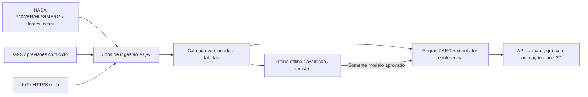

# Gaiapus 09 — execução e operação do backend

| Marco | Dados/IA | Produto/App | Hardware |
|---|---|---|---|
| Dia 1 · provar entrada | Executar as consultas curtas, auditar MG, fixar AOI e apontar lacunas de rótulo | Abrir repositório novo, definir contrato, usar arquivos de amostra no mapa | Preparar simulador e formulário de coleta de campo |
| Primeira semana · primeira entrega integrada | Versionar um pacote, importar portaria ZARC de uma cultura e iniciar arquivo de ciclos GFS | Entregar histórico de Uberlândia pela API real, seletor, fontes e estado sem cobertura | Integrar simulador e testar duplicata/desconexão |
| Próximo incremento · dois modos | Comparar dois cenários de água; parametrizar cultura e coletar dados reais. Revisar com agrônomo | Implementar formulário pré-plantio e simulador pós-plantio com slider e tabelas; 3D consome a mesma resposta | Calibrar sonda, registrar solo/profundidade e iniciar série consentida |
| Após dados suficientes | Comparar MLP, baselines e simulador; congelar relatório e versão antes de publicar | Ativar inferência aprovada, teste de degradação e rollback | Medir qualidade operacional e manutenção |

**Jobs, não chamadas no clique:** HLS consulta novos itens periodicamente e tolera lacunas; IMERG Early/Late chega com atraso, Final reconcilia histórico preservando revisões; GFS atualiza quando houver ciclo novo e guarda histórico do emitido; sensores chegam de forma assíncrona e mantêm fila local. Não prometer atualização contínua de satélites. Expor fonte, época da observação, época de disponibilização, previsão emitida e idade. Se a fonte falhar, manter última versão válida marcada como antiga e desligar previsão se ela ultrapassar a validade.

**Rotas adicionais propostas:** `POST /v1/fields/{field_id}/scenarios` recebe modo, cultura, corte, condição inicial e alterações por dia; retorna `scenario_id`, `input_snapshot_id`, versão do simulador/modelo, tipo de cenário e resultados, ou `202` se for job longo. `GET /v1/fields/{field_id}/scenarios/{scenario_id}` recupera o status e a série. `POST /v1/fields/{field_id}/recommendations` reaproveita snapshots e responde elegibilidade, ordenação, razões e insumos pendentes. Guardar semente se houver amostragem e separar acesso por campo/usuário. A referência estática de 2024 é apenas um caso de teste.

**Implantação do modelo:** registrar versão imutável de código, dados, esquema, métricas, horizonte e validade geográfica. Treinar fora do servidor de requisições; implantação via artefato promovido. Se fonte atrasar, a MLP não extrapola silenciosamente. Devolver baseline aprovado com fonte e versão, ou status sem suporte. Manter log de drift, cobertura, latência, entrada faltante e reversão de versão. Reter dados de fazenda só no escopo consentido.

**Aceite operacional:** reexecutar um cenário com o mesmo snapshot e obter a mesma série; mudar só a chuva e manter parâmetros do talhão; a interface identifica a alteração como hipótese, não dado real. Checar baixa cobertura HLS, previsão expirada, ausência de custo, sensor atrasado, região fora do Brasil e modelo incompatível com o município. Testar que um caso rejeitado não contamina cache, gráfico nem ranking.
