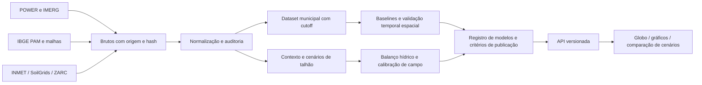

# Gaiapus — base de treinamento MG/MT e decisões para implementação

> **Atualização v2 (14/11/2026):** consulte a [validação INMET, contexto de Campo Novo e ponderação agrícola](gaiapus-17-validacao-espacial-v2.md) e os [resultados comparativos](gaiapus-18-resultados-v2.md). Este guia preserva o contexto v1; os novos resultados e limitações estão nos guias 17–18.

Data de preparação: 13–14/11/2026. Escopo aprovado: preparação autônoma dos dados e da arquitetura, priorizando qualidade; teto autorizado de download de 300 GB. Esse teto não é uma meta de volume.

## Comece aqui amanhã

1. Leia este documento e o [catálogo dos dados](gaiapus-14-catalogo-e-qualidade.md).
2. Abra `data/processed/training_v1/quality_report.json`, `research_samples.csv` e `baseline_validation.csv`.
3. Execute os testes e reproduza o treinamento de referência conforme o [protocolo de treinamento](gaiapus-15-protocolo-de-treinamento.md).
4. Divida o trabalho de implementação seguindo os [contratos e tarefas de backend/frontend](gaiapus-16-arquitetura-e-execucao.md).
5. Para a demonstração de seca, continue também o [replay por fase](gaiapus-12-zarc-e-seca-por-fase.md). Ele é um conjunto de cenários, não observações de colheitas de talhões.

## O que foi efetivamente preparado

| Entrega | Resultado |
|---|---|
| Histórico meteorológico | 70.128 município-dias, 01/01/2001–31/12/2024, oito pontos dentro de municípios; oito variáveis; UTC |
| Agregados mensais | 2.304 registros, com cobertura e indicadores climáticos |
| Alvos agrícolas IBGE | 368 registros município × cultura × ano; 359 válidos segundo as regras desta versão |
| Dataset cruzado | 351 amostras de pesquisa, com data de corte, ano de colheita, divisão temporal e reserva espacial |
| Exclusões de candidatos | 17: oito registros de milho de 2002 ausentes da consulta da tabela 839, e nove registros sem alvo válido; detalhamento no relatório |
| ZARC | 240 perfis oficiais de soja/milho 2ª safra para os oito municípios, safra 2026/27; não usados como histórico de plantios |
| Solo | 160 registros SoilGrids: 140 completos com médias/quantis e 20 sem valor na origem no ponto de Campo Novo do Parecis; ausência preservada |
| Estações | Arquivo INMET 2024 e extratos de oito estações próximas; 2.928 estação-dias, dos quais 2.072 com 24 horas válidas de chuva |
| Modelos de referência | Ridge e HistGradientBoosting treinados separadamente por cultura; comparação com média histórica defasada; arquivos em `data/models/research_v1/` |
| Validação | 2019–2021, separando municípios conhecidos de dois municípios não vistos no ajuste; teste 2022–2024 sem avaliação |

Todos os brutos são preservados. Consultas novas registram URL, data de obtenção, tamanho e SHA-256. O catálogo consolidado `data/processed/training_v1/delivery_manifest.json` permite conferir os arquivos finais. Os scripts não alteram os demonstradores de frontend existentes.

## Nicho escolhido e motivo

**Soja e milho de segunda safra, inicialmente MG e MT.** São duas culturas e dois sistemas sazonais relacionados, mas com respostas e calendários distintos. A transição soja → milho exige considerar a data de colheita da soja. Não há justificativa nesta rodada para incluir café, hortaliças, São Paulo ou uma rede global de municípios antes de resolver o alinhamento espacial e os rótulos.

| MG | MT |
|---|---|
| Uberlândia — 3170206 | Sorriso — 5107925 |
| Uberaba — 3170107 | Sinop — 5107909 |
| Unaí — 3170404 | Lucas do Rio Verde — 5105259 |
| Paracatu — 3147006 | Campo Novo do Parecis — 5102637 |

A escolha é intencional para um piloto agrícola regional; não constitui amostragem estatística representativa dos estados. Uberaba e Sinop ficam reservados para avaliar transferência espacial. Uma futura ampliação deve selecionar municípios por área cultivada, continuidade dos alvos, diversidade de clima/solo e independência espacial, antes de baixar imagens.

## Quatro motores, responsabilidades distintas

1. **Produtividade regional:** aprende relações entre clima e rendimento municipal em kg/ha. Alvo inicial: IBGE PAM; experiência retrospectiva, não promessa de precisão por talhão.
2. **Simulação hídrica de talhão:** balanço diário com solo, raízes, plantio, fase, irrigação e evapotranspiração. Primeiro físico e explícito; somente após calibração vincular déficit a perda de rendimento.
3. **Escolha de cultivo:** aplica restrições agronômicas, ZARC, calendário fitossanitário, disponibilidade de água e manejo; compara produtividade, margem e critérios de solo como objetivos separados.
4. **Previsão meteorológica:** consome previsões e ensembles de fornecedores adequados. Não será uma MLP treinada com oito séries municipais tentando substituir um modelo meteorológico.

O globo e a simulação 3D são visualizações desses motores. Cor, altura e animação devem representar um estado calculado e identificado como observado, estimado ou cenário; gráficos 3D não validam um modelo agronômico.

## Limite científico da entrega

**A base está preparada para experimentação reproduzível; ainda não está validada para aconselhar rendimento ou lucro de uma fazenda.**

- Um ponto interno à malha municipal não é a média meteorológica da área cultivada. A próxima melhoria prioritária é ponderar células meteorológicas pela área da cultura no ano correspondente. Um pixel HLS de demonstração também não é amostra representativa do município.
- A PAM não fornece cultivar, dia real de plantio, irrigação ou produtividade de cada talhão. Não inferir esses campos silenciosamente.
- Há 351 amostras de colheita, não 70.128. Multiplicar cada alvo anual por todos os dias ou pixels criaria pseudorreplicação.
- Os brutos são fotografias das versões disponíveis agora. Os produtos finais e os alvos revisados não reproduzem necessariamente o que estava disponível numa data passada. O benchmark é retrospectivo; simular operação exige versões e datas de publicação históricas.
- As janelas fixas do dataset não comprovam que a cultura estava na mesma fase em todos os anos. O corte de soja em 31/janeiro pode ocorrer depois da colheita de variedades precoces; não apresentar essa experiência como previsão pré-colheita garantida.
- SoilGrids é estimativa espacial, INMET pode estar distante e as estações têm falhas. Nenhum deles deve virar uma leitura de sensor no frontend.

## Prioridade de informação para uma colheita

**Essencial:** água disponível às raízes, chuva e distribuição temporal, temperatura e extremos por fase, radiação, demanda evaporativa, data de plantio, cultivar/ciclo, solo explorável e manejo de irrigação. Para aprender rendimento são essenciais também peso colhido, área efetivamente colhida e umidade de referência.

**Complementar após controle de qualidade:** NDVI/EVI e cobertura do dossel, curva fenológica, textura/carbono/densidade, relevo, histórico da cultura anterior e fertilização. NDVI é indicador de vegetação; isoladamente não identifica a causa do estresse nem determina produtividade.

**Não usar como atalho:** umidade do ar como se fosse umidade do solo; classificação ZARC como probabilidade de perda observada; preço como explicação física da produtividade; chuva acumulada anual como substituto da seca durante florescimento; imagem RGB como rótulo de cultura; dias simulados como safras reais.

## Decisão sobre redes neurais

A primeira hipótese operacional é um modelo tabular pequeno, apoiado por um simulador hídrico. A MLP será um concorrente controlado depois das correções prioritárias, com exatamente os mesmos alvos e divisões. A complexidade só cresce se melhorar validação temporal e espacial com estabilidade. Não há volume independente suficiente nesta primeira coorte para justificar uma rede grande ou modelo de imagem treinado do zero.

O treinamento inicial já executado comprova o caminho ingestão → dataset → modelo → métricas. Ele não comprova que a aplicação está pronta para uso agrícola. Consulte as métricas completas e as condições para avançar no protocolo.
