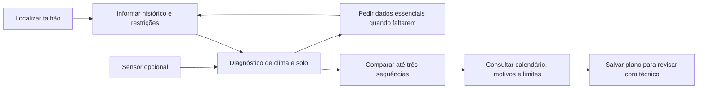
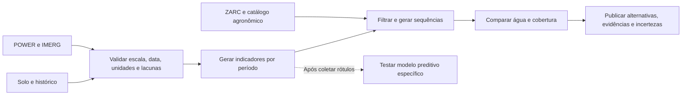
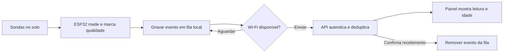

# Gaiapus — Field Shift

**Decisão da equipe:** piloto no Triângulo Mineiro e posicionamento em **Local Impact**. O reconhecimento consta na edição de referência de 2025. Confirmar categorias e critérios da edição de 2026 com a organização. [Prêmios de 2025](https://www.spaceappschallenge.org/2025/awards/) · [Field Shift 2026](https://www.spaceappschallenge.org/2026/challenges/field-shift-adapting-farms-with-nasa-data/)

A Gaiapus ajuda o produtor a decidir o que plantar no próximo ciclo e como manter o solo coberto na entressafra. O sistema compara sequências de cultivo por talhão e explica o que muda com água disponível, época de plantio, histórico e prioridade do produtor.

## Piloto e impacto

Começar no entorno de Uberlândia com um talhão de culturas anuais. Recrutar um produtor e um agrônomo para definir a primeira decisão real. Se houver acesso, testar depois com 3–5 propriedades de diferentes portes. Um produtor familiar pode usar o aplicativo com apoio da assistência técnica e sem comprar um kit. Propriedades maiores podem instalar pontos em diferentes zonas de manejo. A região tem iniciativas de acesso à irrigação para agricultores familiares. [Irriga Minas](https://www.agenciaminas.mg.gov.br/noticia/kits-de-irrigacao-distribuidos-pelo-governo-de-minas-beneficiam-agricultores-familiares-do-triangulo-e-alto-paranaiba-119446)

Avaliar se o produtor entende o motivo de uma opção subir ou sair da lista e se o agrônomo considera a comparação coerente. Registrar onde faltam dados. Ganhos de água, produtividade ou carbono exigem acompanhamento de campo.

## Aplicativo web

Uma PWA em português com cadastro do talhão, diagnóstico, comparação e detalhe do plano. Cadastro por ponto no mapa, data de plantio pretendida, cultivos anteriores, sequeiro ou irrigado, solo conhecido, limitações operacionais e prioridade de água ou cobertura. Resultado com até três sequências, calendário, riscos e evidências. Diagnóstico mostra se a informação é regional, estimada ou medida em campo, com data e profundidade onde aplicável. O painel do sensor mostra última leitura, bateria e idade do dado. O último diagnóstico pode ser consultado offline, com data visível.

## Dados e motor de recomendação

| Fonte | Uso | Escala e prioridade |
|---|---|---|
| NASA POWER | Temperatura diária e radiação | MVP. Serviço de dados com grade conforme a variável. |
| GPM / IMERG | Chuva acumulada e períodos secos | MVP. Grade de 0,1°. Usar Final Run para histórico e registrar a versão. |
| SMAP L4 | Contexto de umidade superficial e da zona radicular | Extensão. Estimativa em grade de 9 km. |
| HLS (Landsat + Sentinel-2) | Cobertura e índices de vegetação | Extensão. Pixels de 30 m e filtro de nuvens. |
| ZARC / MAPA | Janelas de semeadura por município, cultura, solo e ciclo | MVP. Consultar a portaria da safra aplicável. |
| Embrapa e agrônomo | Ciclo, demanda hídrica, cobertura, resíduos e compatibilidade entre culturas | MVP. Catálogo com fonte e revisão. |
| SoilGrids, análise e histórico local | Textura e outras propriedades, cultivos e manejo | Preferir análise local quando disponível. SoilGrids a 250 m serve de contexto. |

Testar até quatro entradas no catálogo. Milho, soja, milheto e crotalária são candidatos sujeitos ao perfil do piloto. Registrar duração do ciclo, janela, fase sensível à água, cobertura, exigências de solo, restrições de sucessão, disponibilidade e fonte. Avaliar o efeito de cada sequência sob o manejo informado.

O MVP usa regras versionadas e comparação multicritério. Primeiro filtra calendário, solo e restrições. Depois compara água e cobertura em cenários históricos com regras explícitas. Mostrar fatores separadamente e indicar lacunas. Se faltarem dados essenciais, retornar análise limitada. Uma leitura pontual recente altera o diagnóstico de campo conforme regra revisada, sem alterar automaticamente a janela do ZARC nem a caracterização regional.

Preservar dados brutos, versão, data de observação e disponibilidade, unidade, resolução e flags. Harmonizar a referência temporal e manter lacunas sinalizadas. Usar apenas informação disponível na data simulada. Para evolução, testar regressão ou gradient boosting para prever umidade local em 24 h após coletar séries reais por propriedade e profundidade. Comparar MAE com persistência, reservar períodos futuros e propriedades distintas. Rede neural fica como hipótese para quando houver dados e uma referência a superar.

[POWER](https://power.larc.nasa.gov/docs/services/api/temporal/daily/) · [IMERG](https://gpm.nasa.gov/resources/faq/what-are-differences-between-imerg-early-late-and-final-runs-and-which-should-be-used) · [SMAP L4](https://gmao.gsfc.nasa.gov/gmao-products/smap-l4/) · [HLS](https://hls.gsfc.nasa.gov/data-products/) · [ZARC](https://www.gov.br/agricultura/pt-br/assuntos/riscos-seguro/programa-nacional-de-zoneamento-agricola-de-risco-climatico/zoneamento-agricola) · [Embrapa](https://www.embrapa.br/web/agencia-de-informacao-tecnologica/tematicas/sistema-plantio-direto/fazendo-certo/planejando-e-executando/fase-de-implantacao/organizando-o-sistema-produtivo/rotacao-de-culturas) · [SoilGrids](https://maps.isric.org/soilgrids.html)

## Dispositivo IoT

Protótipo com ESP32, sonda de umidade calibrável e sensor de temperatura do solo, instalados em ponto e profundidade registrados. Medir consumo antes de dimensionar bateria, caixa e eventual painel solar. Usar Wi-Fi na demonstração, avaliar LoRaWAN com gateway e teste de cobertura para o campo. Oferecer instalação e manutenção via cooperativa ou assistência técnica no piloto. Planejar pontos adicionais por zona de manejo.

Cada evento contém ID único, ID do dispositivo, horário UTC, profundidade em cm, temperatura em °C, tensão de bateria em mV e qualidade. A umidade é volumétrica em m³/m³ quando calibrada. Antes disso, enviar leitura bruta e umidade volumétrica nula. Associar ponto, talhão e versão de calibração no cadastro. Se a rede cair, preservar as leituras localmente e retransmitir com deduplicação.

[Plano de execução do MVP](docs/superpowers/plans/2026-11-11-gaiapus-mvp.md)

